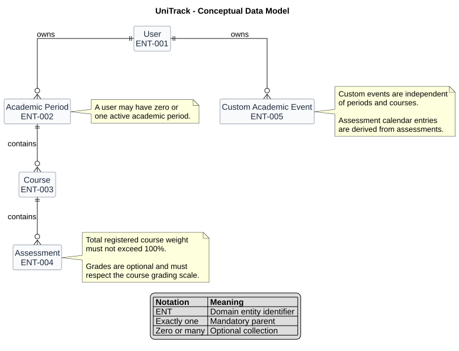
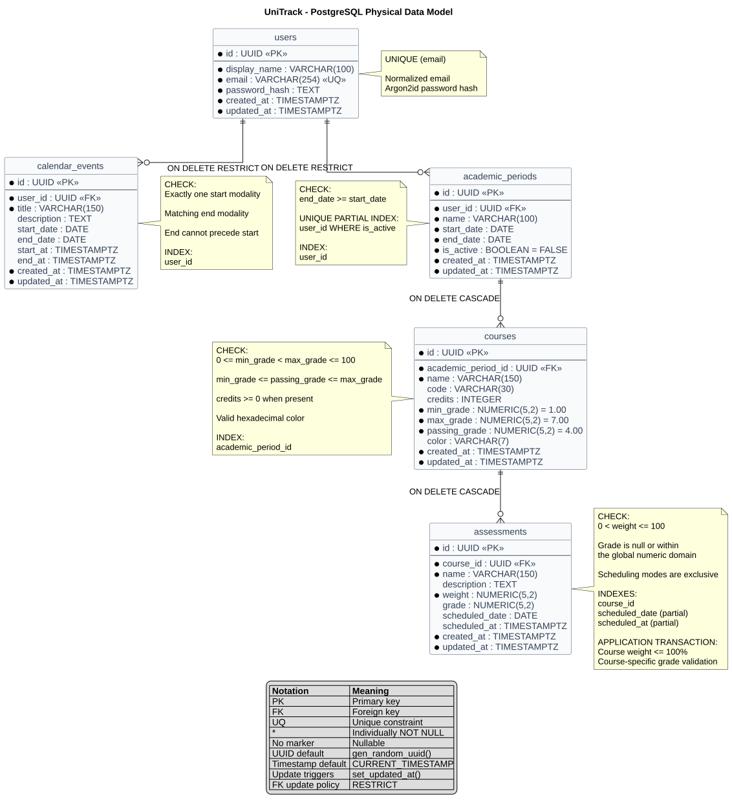

# UniTrack — Database Design

## Document Information

| Field | Value |
|---|---|
| Project | UniTrack |
| Document | Database Design |
| Version | 1.0 |
| Status | Initial Physical Database Design Specification |
| Project Phase | Phase 0 - Planning and Design |
| Target DBMS | PostgreSQL |

## 1. Introduction

### 1.1. Purpose

This document defines the database design of UniTrack.

Its purpose is to establish a consistent relational data
model that supports the approved functional requirements,
academic business rules, and use case specifications.

The database design shall provide a foundation for data
persistence, academic information management, referential
integrity, resource ownership, and reliable academic
performance calculations.

### 1.2. Scope

The database design applies to the Minimum Viable Product
defined in the Project Overview.

The model focuses on the persistent academic domain,
including:

- User accounts.
- Academic periods.
- Courses.
- Assessments.
- Custom academic events.

Technical persistence structures required by authentication,
session management, or infrastructure may be introduced
during subsequent architectural design.

### 1.3. Related Specifications

The database design is based on:

- [Project Overview](../planning/project-overview.md)
- [Software Requirements](../planning/requirements.md)
- [Business Rules](../planning/business-rules.md)
- [Use Case Model](use-cases.md)

## 2. Database Design Principles

The database design follows these principles:

- Use the relational data model.
- Achieve at least Third Normal Form.
- Preserve referential integrity.
- Minimize unnecessary data redundancy.
- Maintain explicit ownership relationships.
- Distinguish missing values from numerical zero.
- Separate authoritative data from derived indicators.
- Use precise decimal representations for academic values.
- Support schema evolution through database migrations.
- Avoid unnecessary entities outside the approved MVP scope.

The conceptual model describes domain entities and their
relationships independently of database implementation.

The logical model defines relational tables, attributes,
candidate keys, primary keys, and foreign keys.

The physical model will define PostgreSQL data types,
constraints, indexes, and transactional enforcement.

## 3. Modeling Conventions

### 3.1. Identification

| Prefix | Meaning |
|---|---|
| ENT | Domain Entity |
| REL | Entity Relationship |
| FR | Functional Requirement |
| NFR | Non-Functional Requirement |
| BR | Business Rule |
| UC | Use Case |

Entity and relationship identifiers are documentation
references rather than persisted database attributes.

### 3.2. Naming Conventions

| Element | Convention | Example |
|---|---|---|
| Table names | English, plural, snake_case | academic_periods |
| Attribute names | English, snake_case | passing_grade |
| Primary keys | id | users.id |
| Foreign keys | Referenced entity name followed by _id | course_id |
| Boolean attributes | Descriptive boolean names | is_active |
| Calendar dates | Suffix _date | start_date |
| Timestamps | Suffix _at | created_at |

### 3.3. Key Notation

| Symbol | Meaning |
|---|---|
| PK | Primary Key |
| FK | Foreign Key |
| AK | Alternate Candidate Key |
| NULL | Optional attribute value |

### 3.4. Identifier Strategy

All primary domain tables will use UUID identifiers.

Identifiers shall remain independent of descriptive names,
email addresses, academic codes, and other mutable data.

UUID values shall not be treated as authorization mechanisms.

Resource ownership must be verified independently.

The UUID generation strategy will be defined during physical
database and application design.

## 4. Domain Analysis

The database must support the six functional modules
identified during requirements analysis.

| Module | Persistence Responsibility |
|---|---|
| User Management | User identity and authentication information. |
| Academic Management | Academic periods and courses. |
| Assessment Management | Assessments, weights, grades, and scheduling information. |
| Performance Analysis | Derived calculations using academic source data. |
| Academic Calendar | Scheduled assessments and custom academic events. |
| Academic Dashboard | Consolidated information derived from the active period. |

Not every functional module requires an independent
database table.

Performance analysis and dashboard information shall be
derived from existing academic records.

## 5. Conceptual Entity Model

### 5.1. Entity Catalog

| ID | Entity | Responsibility |
|---|---|---|
| ENT-001 | User | Represents a registered account and academic data owner. |
| ENT-002 | Academic Period | Represents a user-defined academic interval. |
| ENT-003 | Course | Represents a course registered within an academic period. |
| ENT-004 | Assessment | Represents an evaluation contributing to a course grade. |
| ENT-005 | Custom Academic Event | Represents a personal calendar event independent of assessments. |

### 5.2. ENT-001 — User

The User entity represents a registered individual
interacting with UniTrack.

A user owns academic periods and custom academic events.

Conceptual attributes:

| Attribute | Required | Description |
|---|---|---|
| User identifier | Yes | Unique account identifier. |
| Display name | Yes | Name displayed within the application. |
| Email | Yes | Unique normalized account email. |
| Password hash | Yes | Secure password representation. |
| Creation timestamp | Yes | Account creation time. |
| Update timestamp | Yes | Most recent account modification time. |

Primary identifier: User identifier.

Alternate identifier: Normalized email address.

Related requirements: FR-001 to FR-007.

Related business rules: BR-001 to BR-005.

User roles are not modeled separately because the MVP
does not define distinct registered user permission roles.

### 5.3. ENT-002 — Academic Period

An Academic Period represents an academic interval
defined by a registered user.

It may represent a semester, trimester, summer period,
or another user-defined academic interval.

Conceptual attributes:

| Attribute | Required | Description |
|---|---|---|
| Period identifier | Yes | Unique academic period identifier. |
| Owner | Yes | User who owns the academic period. |
| Name | Yes | Descriptive period name. |
| Start date | Yes | First calendar date of the period. |
| End date | Yes | Last calendar date of the period. |
| Active status | Yes | Indicates the selected academic context. |
| Creation timestamp | Yes | Record creation time. |
| Update timestamp | Yes | Most recent record modification time. |

Primary identifier: Period identifier.

Related requirements: FR-008 to FR-013.

Related business rules: BR-006 to BR-013.

Academic period names do not represent unique identifiers.

Overlapping periods are permitted.

The active status represents a user-selected context
rather than a condition determined automatically by dates.

### 5.4. ENT-003 — Course

A Course represents an individual course registered
within a specific academic period.

Conceptual attributes:

| Attribute | Required | Description |
|---|---|---|
| Course identifier | Yes | Unique course identifier. |
| Academic period | Yes | Parent academic period. |
| Name | Yes | Descriptive course name. |
| Code | No | Optional academic course code. |
| Credits | No | Optional academic credit value. |
| Minimum grade | Yes | Minimum permitted grade. |
| Maximum grade | Yes | Maximum permitted grade. |
| Passing grade | Yes | Minimum final grade required to pass. |
| Color | No | Optional course display color. |
| Creation timestamp | Yes | Record creation time. |
| Update timestamp | Yes | Most recent record modification time. |

Primary identifier: Course identifier.

Related requirements: FR-014 to FR-020.

Related business rules: BR-014 to BR-020.

A course represents a period-specific academic record
rather than an institution-wide course catalog entry.

Courses with identical names or codes may exist in
different academic periods.

Course codes are not treated as unique identifiers.

Grading parameters are stored directly within each course.

Academic credits and display colors are planned optional
features and may be deferred during MVP implementation.

### 5.5. ENT-004 — Assessment

An Assessment represents an evaluation component
associated with an individual course.

Conceptual attributes:

| Attribute | Required | Description |
|---|---|---|
| Assessment identifier | Yes | Unique assessment identifier. |
| Course | Yes | Parent course. |
| Name | Yes | Assessment name. |
| Description | No | Additional assessment information. |
| Weight | Yes | Percentage contribution to the final course grade. |
| Grade | No | Current numerical assessment grade. |
| Scheduled date or timestamp | No | Scheduled academic activity or deadline. |
| Creation timestamp | Yes | Record creation time. |
| Update timestamp | Yes | Most recent record modification time. |

Primary identifier: Assessment identifier.

Related requirements: FR-021 to FR-032, FR-034.

Related business rules: BR-021 to BR-038, as applicable.

The current grade is stored directly in the assessment.

A missing grade is represented by null.

The grading status is derived from grade availability
and is not stored as an independent attribute.

An assessment may exist without a scheduled date.

### 5.6. ENT-005 — Custom Academic Event

A Custom Academic Event represents a personal calendar
item created independently of registered assessments.

Conceptual attributes:

| Attribute | Required | Description |
|---|---|---|
| Event identifier | Yes | Unique event identifier. |
| Owner | Yes | User who owns the event. |
| Title | Yes | Descriptive event title. |
| Description | No | Additional event information. |
| Start date or timestamp | Yes | Beginning of the event. |
| End date or timestamp | No | Optional ending of the event. |
| Creation timestamp | Yes | Record creation time. |
| Update timestamp | Yes | Most recent record modification time. |

Primary identifier: Event identifier.

Related requirements: FR-036, FR-037.

Related business rules: BR-003, BR-005, BR-039.

Custom academic events belong directly to users.

They do not depend on academic periods or courses.

Custom academic event functionality retains its Should
priority within the approved MVP scope.

## 6. Entity Relationships

### 6.1. Relationship Catalog

| ID | Parent Entity | Relationship | Dependent Entity |
|---|---|---|---|
| REL-001 | User | Owns | Academic Period |
| REL-002 | Academic Period | Contains | Course |
| REL-003 | Course | Contains | Assessment |
| REL-004 | User | Owns | Custom Academic Event |

### 6.2. Cardinalities

| Relationship | Parent Participation | Dependent Participation |
|---|---|---|
| REL-001 | A user owns zero or many periods. | Each period belongs to exactly one user. |
| REL-002 | A period contains zero or many courses. | Each course belongs to exactly one period. |
| REL-003 | A course contains zero or many assessments. | Each assessment belongs to exactly one course. |
| REL-004 | A user owns zero or many custom events. | Each event belongs to exactly one user. |

All dependent entities have mandatory parent relationships.

Parent entities may exist without dependent records.

### 6.3. REL-001 — User and Academic Period

Relationship type: One-to-many.

An academic period cannot exist without an owning user.

A user may have no academic periods or multiple academic
periods.

At most one academic period may be active for a user.

Related business rules: BR-006, BR-007, BR-010, BR-011.

### 6.4. REL-002 — Academic Period and Course

Relationship type: One-to-many.

A course cannot exist without an associated academic period.

An academic period may contain no courses or multiple courses.

Course ownership is inherited from the associated period.

Related business rules: BR-012, BR-014.

### 6.5. REL-003 — Course and Assessment

Relationship type: One-to-many.

An assessment cannot exist without an associated course.

A course may contain no assessments or multiple assessments.

Assessment ownership is inherited from the corresponding
course and academic period.

Related business rules: BR-020, BR-021.

### 6.6. REL-004 — User and Custom Academic Event

Relationship type: One-to-many.

A custom academic event cannot exist without an owning user.

A user may register zero or multiple custom academic events.

Custom events do not depend on academic periods or courses.

Related business rules: BR-039.

### 6.7. Conceptual Entity-Relationship Diagram

[PlantUML source](../diagrams/database/conceptual-model.puml)

## 7. Resource Ownership and Entity Lifecycle

### 7.1. Ownership Hierarchy

Academic resource ownership follows the hierarchy:

    User
      Academic Period
        Course
          Assessment

Custom academic events belong directly to the User entity.

The owner of a course is determined through its associated
academic period.

The owner of an assessment is determined through its
associated course and academic period.

Redundant user identifiers shall not be stored within
courses or assessments.

This prevents conflicting ownership information and
preserves a single authoritative ownership path.

Foreign key relationships do not replace application-level
authentication and authorization enforcement.

### 7.2. Entity Dependency

| Entity | Mandatory Parent |
|---|---|
| User | None |
| Academic Period | User |
| Course | Academic Period |
| Assessment | Course |
| Custom Academic Event | User |

### 7.3. Deletion Semantics

| Deleted Entity | Expected Domain Behavior |
|---|---|
| Academic Period | Remove its associated courses and assessments. |
| Course | Remove its associated assessments. |
| Assessment | Remove the assessment and its derived calendar information. |
| Custom Academic Event | Remove only the selected event. |
| User | Account deletion policy remains outside the current functional scope. |

Academic period and course deletion shall follow the
approved business rules for permanent dependent deletion.

Independent custom academic events shall not be removed
when a period or course is deleted.

Deletion operations affecting multiple dependent records
shall execute atomically.

The physical foreign key deletion policies will be
specified during the physical database design.

## 8. Logical Relational Model

### 8.1. Entity-to-Relation Mapping

| Entity | Relation |
|---|---|
| ENT-001 | users |
| ENT-002 | academic_periods |
| ENT-003 | courses |
| ENT-004 | assessments |
| ENT-005 | calendar_events |

One-to-many relationships are implemented logically by
placing foreign keys within their dependent relations.

No many-to-many association tables are required by the
current academic domain model.

### 8.2. Relation: users

    users (
        id PK,
        display_name,
        email AK,
        password_hash,
        created_at,
        updated_at
    )

Primary key:

- id

Alternate candidate key:

- email

The normalized email address must remain unique and
non-null.

All attributes in the current relation are mandatory.

### 8.3. Relation: academic_periods

    academic_periods (
        id PK,
        user_id FK,
        name,
        start_date,
        end_date,
        is_active,
        created_at,
        updated_at
    )

Primary key:

- id

Foreign key:

- user_id references users.id

All attributes in the current relation are mandatory.

### 8.4. Relation: courses

    courses (
        id PK,
        academic_period_id FK,
        name,
        code,
        credits,
        min_grade,
        max_grade,
        passing_grade,
        color,
        created_at,
        updated_at
    )

Primary key:

- id

Foreign key:

- academic_period_id references academic_periods.id

Nullable attributes:

- code
- credits
- color

Credits and color belong to optional MVP functionality.

### 8.5. Relation: assessments

    assessments (
        id PK,
        course_id FK,
        name,
        description,
        weight,
        grade,
        scheduled_date,
        scheduled_at,
        created_at,
        updated_at
    )

Primary key:

- id

Foreign key:

- course_id references courses.id

Nullable attributes:

- description
- grade
- scheduled_date
- scheduled_at

The scheduled date and timestamp attributes are mutually
exclusive.

Both scheduling attributes may be null.

### 8.6. Relation: calendar_events

    calendar_events (
        id PK,
        user_id FK,
        title,
        description,
        start_date,
        end_date,
        start_at,
        end_at,
        created_at,
        updated_at
    )

Primary key:

- id

Foreign key:

- user_id references users.id

Individually nullable attributes:

- description
- start_date
- end_date
- start_at
- end_at

Exactly one start modality must be provided.

The optional end modality must be consistent with
the selected start modality.

### 8.7. Logical Key Summary

| Relation | Primary Key | Foreign Keys | Alternate Key |
|---|---|---|---|
| users | id | None | email |
| academic_periods | id | user_id | None |
| courses | id | academic_period_id | None |
| assessments | id | course_id | None |
| calendar_events | id | user_id | None |

All foreign keys within the five domain relations
are mandatory.

### 8.8. Logical Model Summary

| Relation | Attributes | Primary Keys | Foreign Keys |
|---|---:|---:|---:|
| users | 6 | 1 | 0 |
| academic_periods | 8 | 1 | 1 |
| courses | 11 | 1 | 1 |
| assessments | 10 | 1 | 1 |
| calendar_events | 10 | 1 | 1 |
| **Total** | **45** | **5** | **4** |

The model contains one additional alternate candidate key.

Technical persistence relations required by authentication
or infrastructure are not included in this summary.

### 8.9. Logical Relational Diagram

[PlantUML source](../diagrams/database/relational-model.puml)

## 9. Temporal Data Modeling

### 9.1. Temporal Concepts

The academic domain distinguishes between:

- Calendar dates without a specific time.
- Timezone-aware timestamps representing specific instants.
- Missing scheduling information.

Calendar dates shall preserve their calendar-day meaning.

Timestamp-based information shall support timezone-aware
representation.

The initial presentation timezone is America/Santiago.

### 9.2. Academic Period Dates

Academic period boundaries use calendar dates.

The end date shall not precede the start date.

Academic period boundaries do not automatically restrict
the scheduling of assessments.

### 9.3. Assessment Scheduling

Assessment scheduling uses two mutually exclusive
attributes:

- scheduled_date
- scheduled_at

| scheduled_date | scheduled_at | Validity |
|---|---|---|
| Null | Null | Valid unscheduled assessment. |
| Value | Null | Valid date-only assessment. |
| Null | Value | Valid timestamp-based assessment. |
| Value | Value | Invalid scheduling state. |

A date-only assessment shall not be assigned an artificial
time merely to satisfy a timestamp representation.

### 9.4. Custom Academic Event Scheduling

Custom academic events support two temporal modalities:

1. Date-only events.
2. Timestamp-based events.

Date-only events use start_date and optionally end_date.

Timestamp-based events use start_at and optionally end_at.

The following conditions apply:

- Exactly one start modality is required.
- End values are optional.
- Start and end modalities must match.
- End values cannot precede start values.
- Date-only end dates are inclusive.
- A date-only event without an end date represents a
  single-day event.
- A timestamp-based event without an end timestamp
  represents a point-in-time event.

The temporal modality is derived from the populated fields.

### 9.5. Upcoming Assessment Semantics

Unscheduled assessments shall not be considered upcoming.

A date-only assessment is considered upcoming when its
calendar date is equal to or later than the current date
in the application presentation timezone.

A timestamp-based assessment is considered upcoming
when its scheduled instant is equal to or later than
the current instant.

Date-only assessments remain upcoming throughout their
scheduled calendar day.

Detailed ordering and API serialization conventions
will be established during API design.

## 10. Persistent and Derived Information

### 10.1. Authoritative Source Data

The database stores authoritative academic information,
including:

- Academic period information.
- Course grading configuration.
- Assessment grades and weights.
- Assessment scheduling information.
- Custom academic events.

### 10.2. Derived Academic Indicators

The following information shall be calculated from
authoritative academic data:

- Registered assessment weight.
- Graded assessment weight.
- Ungraded assessment weight.
- Unallocated assessment weight.
- Current weighted average.
- Final weighted average.
- Required passing grade.
- Minimum possible final average.
- Maximum possible final average.
- Academic status.
- Period-wide performance indicators when supported.

These values shall not be stored as independently editable
source attributes in the initial relational model.

Calculation formulas and precision policies are defined
in the Business Rules document.

### 10.3. Calendar Information

The academic calendar combines scheduled assessment
information with custom academic event information.

Scheduled assessments shall be retrieved directly from
assessment records.

They shall not be duplicated within the calendar_events
relation.

### 10.4. Dashboard Information

The academic dashboard derives information from:

- The selected active academic period.
- Courses associated with that period.
- Assessment source data.
- Academic calculation services.

A separate dashboard relation is not required.

## 11. Considered and Excluded Relations

| Potential Relation | Design Decision |
|---|---|
| grades | Current grades are stored directly in assessments. |
| grading_scales | Grading parameters are stored directly in courses. |
| subjects | No institutional course catalog is required. |
| enrollments | Courses already belong to individual academic periods. |
| academic_performance | Academic indicators are derived. |
| dashboard | Dashboard information is derived. |
| roles | Distinct registered user roles are outside the MVP. |
| universities | Institutional management is outside the MVP. |
| assessment_types | Formal assessment classifications are not required. |
| notifications | Notification functionality is outside the MVP. |
| user_sessions | Pending authentication architecture decisions. |

Excluded relations may be reconsidered if future
requirements introduce an independent persistence need.

## 12. Normalization Analysis

### 12.1. Normalization Objective

The relational model aims to reduce unnecessary data
redundancy and avoid insertion, update, and deletion
anomalies.

The analysis considers the functional dependencies
identified within the approved academic domain.

### 12.2. First Normal Form

All relations represent individual records and attributes
with scalar domain values.

Repeating collections of academic periods, courses,
assessments, and events are represented through separate
relations rather than repeating attribute groups.

The proposed relations satisfy First Normal Form.

### 12.3. Second Normal Form

The identified candidate keys of the proposed relations
consist of individual attributes.

No non-prime attribute depends on only part of a
composite candidate key.

The proposed relations satisfy Second Normal Form.

### 12.4. Third Normal Form

For each non-trivial functional dependency X -> A,
Third Normal Form requires X to be a superkey or A
to be a prime attribute.

The proposed relations avoid redundant descriptive
attributes inherited from parent entities.

Examples include:

- Period names are stored in academic_periods rather
  than courses.
- Course names are stored in courses rather than
  assessments.
- User ownership is derived through foreign key
  relationships rather than duplicated.

Under the identified functional dependencies, all
proposed relations satisfy Third Normal Form.

### 12.5. Functional Dependencies

The following notation defines the relevant functional
dependencies of each relation.

#### users

Candidate keys:

- {id}
- {email}

Functional dependencies:

    id -> display_name, email, password_hash,
          created_at, updated_at

    email -> id

The normalized email address is an alternate candidate
key and determines all user attributes.

#### academic_periods

Candidate key:

- {id}

Functional dependency:

    id -> user_id, name, start_date, end_date,
          is_active, created_at, updated_at

Period names and dates are not assumed to be unique.

The active-period constraint is a conditional uniqueness
rule rather than a candidate key of the full relation.

#### courses

Candidate key:

- {id}

Functional dependency:

    id -> academic_period_id, name, code, credits,
          min_grade, max_grade, passing_grade,
          color, created_at, updated_at

Course names and codes are not assumed to uniquely
identify course records.

Grading parameters are independently configurable
within the supported academic constraints.

#### assessments

Candidate key:

- {id}

Functional dependency:

    id -> course_id, name, description, weight,
          grade, scheduled_date, scheduled_at,
          created_at, updated_at

Assessment names are not assumed to be unique.

#### calendar_events

Candidate key:

- {id}

Functional dependency:

    id -> user_id, title, description,
          start_date, end_date, start_at, end_at,
          created_at, updated_at

Event titles and temporal values are not assumed to
uniquely identify event records.

### 12.6. Boyce-Codd Normal Form

Boyce-Codd Normal Form requires every determinant of
a non-trivial functional dependency to be a superkey.

Under the identified domain assumptions and functional
dependencies, the proposed relations satisfy BCNF.

This conclusion depends on the completeness of the
identified functional dependencies and is not guaranteed
solely by the use of surrogate UUID primary keys.

### 12.7. Normalization Summary

| Relation | 1NF | 2NF | 3NF | BCNF |
|---|---|---|---|---|
| users | Yes | Yes | Yes | Yes |
| academic_periods | Yes | Yes | Yes | Yes |
| courses | Yes | Yes | Yes | Yes |
| assessments | Yes | Yes | Yes | Yes |
| calendar_events | Yes | Yes | Yes | Yes |

The normalization result is based on the current domain
assumptions and identified functional dependencies.

Additional dependencies introduced by future requirements
must be evaluated independently.

### 12.8. Anomaly Prevention

#### Insertion Anomalies

Parent entities may exist without dependent records.

Users can create academic periods without courses,
courses without assessments, and assessments without grades.

#### Update Anomalies

Descriptive information is maintained in its authoritative
relation rather than duplicated within dependent records.

#### Deletion Anomalies

Deleting a dependent record does not remove its parent.

Parent-to-dependent deletion is intentional only where
required by approved business rules.

## 13. Preliminary Design Decisions

### 13.1. Active Academic Period

The active academic period is represented by the
is_active attribute in academic_periods.

A user may have zero or one active period.

The physical database design shall enforce this restriction
using an appropriate conditional uniqueness mechanism.

Active period replacement shall execute atomically.

### 13.2. Assessment Weight Consistency

Individual assessment weights are stored in assessments.

The total registered assessment weight of a course
shall not exceed 100%.

This is a cross-record constraint and cannot be represented
solely by an ordinary row-level CHECK constraint.

The physical and application designs shall define a
transactional enforcement strategy that remains valid
under concurrent modifications.

A redundant total weight attribute is not included
in the courses relation.

### 13.3. Grade Range Consistency

An assessment grade must respect the grading parameters
of its associated course.

Course grading configuration changes shall not invalidate
existing assessment grades.

Cross-table validation and concurrency requirements
will be addressed during physical and application design.

### 13.4. Creation and Modification Timestamps

All domain relations include creation and modification
timestamps.

These attributes provide basic record lifecycle metadata.

They do not represent a complete modification history
or auditing mechanism.

The physical schema will define their initialization
and update policies.

### 13.5. Optional Feature Persistence

The logical model includes support for:

- Academic credits.
- Course display colors.
- Custom academic events.
- Configurable grading parameters.

These structures represent the planned MVP design.

Their inclusion does not change the priority assigned
to the corresponding functional requirements.

## 14. Data Dictionary

### 14.1. Physical Data Type Strategy

The physical database model uses PostgreSQL data types.

| Data Type | Purpose |
|---|---|
| UUID | Primary and foreign key identifiers. |
| VARCHAR(n) | Text attributes with explicit length limits. |
| TEXT | Descriptions and password hashes. |
| NUMERIC(5,2) | Grades, assessment weights, and grading parameters. |
| INTEGER | Optional academic credits. |
| BOOLEAN | Academic period active status. |
| DATE | Calendar dates without a specific time. |
| TIMESTAMPTZ | Timezone-aware instants and lifecycle timestamps. |

The supported academic numeric domain ranges from
0.00 to 100.00.

Academic grades, grading parameters, and assessment
weights support up to two decimal places.

NUMERIC column coercion may round values exceeding
the declared scale.

The application shall reject unsupported numeric
precision before submitting values to PostgreSQL.

Academic calculations shall use decimal arithmetic
according to BR-037.

### 14.2. Identifier Generation

All five domain relations use UUID primary keys.

Identifiers shall be generated by PostgreSQL using
gen_random_uuid() as the default value.

The application shall treat identifiers as immutable.

UUID values shall not replace authentication or
resource ownership verification.

### 14.3. Common Lifecycle Attributes

All domain relations contain the following attributes:

| Attribute | Type | Nullable | Default |
|---|---|---|---|
| created_at | TIMESTAMPTZ | No | CURRENT_TIMESTAMP |
| updated_at | TIMESTAMPTZ | No | CURRENT_TIMESTAMP |

The creation timestamp shall remain unchanged during
normal update operations.

The update timestamp shall be maintained by a reusable
PostgreSQL BEFORE UPDATE trigger function.

The function shall preserve created_at and assign
clock_timestamp() to updated_at.

These attributes provide basic lifecycle metadata,
not a complete audit history.

### 14.4. Relation: users

Purpose: Store registered user identities and
authentication information.

| Attribute | PostgreSQL Type | Nullable | Default | Description |
|---|---|---|---|---|
| id | UUID | No | gen_random_uuid() | Primary account identifier. |
| display_name | VARCHAR(100) | No | None | Personal display name. |
| email | VARCHAR(254) | No | None | Unique normalized email address. |
| password_hash | TEXT | No | None | Secure password hash. |
| created_at | TIMESTAMPTZ | No | CURRENT_TIMESTAMP | Account creation instant. |
| updated_at | TIMESTAMPTZ | No | CURRENT_TIMESTAMP | Latest account update instant. |

Validation policies:

- Display names shall contain non-whitespace characters.
- Email addresses shall be normalized and unique.
- Email syntax shall be validated by the application.
- Password hashes shall not be empty.
- Password hashes shall be generated using Argon2id.
- Plaintext passwords shall never be persisted.
- Sensitive authentication fields shall not be exposed
  in public API responses.

### 14.5. Relation: academic_periods

Purpose: Store user-defined academic intervals.

| Attribute | PostgreSQL Type | Nullable | Default | Description |
|---|---|---|---|---|
| id | UUID | No | gen_random_uuid() | Primary period identifier. |
| user_id | UUID | No | None | Owning user. |
| name | VARCHAR(100) | No | None | Descriptive period name. |
| start_date | DATE | No | None | First calendar date. |
| end_date | DATE | No | None | Last calendar date. |
| is_active | BOOLEAN | No | FALSE | Selected academic context. |
| created_at | TIMESTAMPTZ | No | CURRENT_TIMESTAMP | Creation instant. |
| updated_at | TIMESTAMPTZ | No | CURRENT_TIMESTAMP | Latest update instant. |

Validation policies:

- The owning user must exist.
- Period names shall not be blank.
- The end date shall not precede the start date.
- Overlapping periods are permitted.
- At most one period may be active per user.
- New periods shall initially be inactive.
- Period ownership shall not be changed through
  normal application operations.

### 14.6. Relation: courses

Purpose: Store individual academic courses and
their grading configurations.

| Attribute | PostgreSQL Type | Nullable | Default | Description |
|---|---|---|---|---|
| id | UUID | No | gen_random_uuid() | Primary course identifier. |
| academic_period_id | UUID | No | None | Parent academic period. |
| name | VARCHAR(150) | No | None | Course name. |
| code | VARCHAR(30) | Yes | NULL | Optional course code. |
| credits | INTEGER | Yes | NULL | Optional academic credits. |
| min_grade | NUMERIC(5,2) | No | 1.00 | Minimum permitted grade. |
| max_grade | NUMERIC(5,2) | No | 7.00 | Maximum permitted grade. |
| passing_grade | NUMERIC(5,2) | No | 4.00 | Minimum passing grade. |
| color | VARCHAR(7) | Yes | NULL | Optional hexadecimal display color. |
| created_at | TIMESTAMPTZ | No | CURRENT_TIMESTAMP | Creation instant. |
| updated_at | TIMESTAMPTZ | No | CURRENT_TIMESTAMP | Latest update instant. |

Validation policies:

- The parent academic period must exist.
- Course names shall not be blank.
- Course codes are optional and not necessarily unique.
- Non-null course codes shall not be blank.
- Credits shall be non-negative integer values.
- Grading parameters shall belong to the supported
  numeric domain.
- The minimum grade shall be lower than the maximum grade.
- The passing grade shall belong to the configured scale.
- Colors shall use the hexadecimal #RRGGBB format.
- Course parent relationships shall remain immutable
  during normal application operations.

### 14.7. Relation: assessments

Purpose: Store academic evaluations and their
corresponding grading and scheduling information.

| Attribute | PostgreSQL Type | Nullable | Default | Description |
|---|---|---|---|---|
| id | UUID | No | gen_random_uuid() | Primary assessment identifier. |
| course_id | UUID | No | None | Parent course. |
| name | VARCHAR(150) | No | None | Assessment name. |
| description | TEXT | Yes | NULL | Optional description. |
| weight | NUMERIC(5,2) | No | None | Percentage contribution. |
| grade | NUMERIC(5,2) | Yes | NULL | Current assessment grade. |
| scheduled_date | DATE | Yes | NULL | Date-only scheduling value. |
| scheduled_at | TIMESTAMPTZ | Yes | NULL | Timestamp-based scheduling value. |
| created_at | TIMESTAMPTZ | No | CURRENT_TIMESTAMP | Creation instant. |
| updated_at | TIMESTAMPTZ | No | CURRENT_TIMESTAMP | Latest update instant. |

Validation policies:

- The parent course must exist.
- Assessment names shall not be blank.
- Descriptions shall contain at most 2000 characters.
- Individual weights shall be greater than zero
  and less than or equal to 100.
- Total registered course weight shall not exceed 100.
- Grades shall respect the associated course scale.
- Missing grades shall be represented by null.
- Scheduling modalities shall be mutually exclusive.
- Unscheduled assessments are valid.
- Assessment parent relationships shall remain immutable
  during normal application operations.

### 14.8. Relation: calendar_events

Purpose: Store user-owned custom academic events.

| Attribute | PostgreSQL Type | Nullable | Default | Description |
|---|---|---|---|---|
| id | UUID | No | gen_random_uuid() | Primary event identifier. |
| user_id | UUID | No | None | Owning user. |
| title | VARCHAR(150) | No | None | Event title. |
| description | TEXT | Yes | NULL | Optional event description. |
| start_date | DATE | Conditional | NULL | Date-only event start. |
| end_date | DATE | Yes | NULL | Inclusive date-only event end. |
| start_at | TIMESTAMPTZ | Conditional | NULL | Timestamp-based event start. |
| end_at | TIMESTAMPTZ | Yes | NULL | Timestamp-based event end. |
| created_at | TIMESTAMPTZ | No | CURRENT_TIMESTAMP | Creation instant. |
| updated_at | TIMESTAMPTZ | No | CURRENT_TIMESTAMP | Latest update instant. |

Validation policies:

- The owning user must exist.
- Event titles shall not be blank.
- Descriptions shall contain at most 2000 characters.
- Exactly one start modality is mandatory.
- End values are optional.
- Start and end modalities shall match.
- End values shall not precede start values.
- Date-only end dates are inclusive.
- Event ownership shall remain immutable during
  normal application operations.

### 14.9. Text Validation Policy

The application shall normalize surrounding whitespace
where appropriate.

Required names and titles shall contain at least one
non-whitespace character.

Optional short text attributes may be represented by null
when no meaningful value is provided.

Text limits are expressed in characters.

Email normalization shall remain consistent with
BR-002 and the database uniqueness mechanism.

### 14.10. Temporal Storage Policy

DATE attributes preserve calendar-day semantics.

TIMESTAMPTZ attributes represent absolute instants
without preserving the original submitted timezone name.

The application shall require timezone-aware timestamp
inputs and present them using America/Santiago by default.

Non-finite date and timestamp values shall be rejected
by the application.

The API serialization format and handling of ambiguous
or nonexistent local times shall be defined during
API design.

## 15. Physical Database Constraints

### 15.1. Constraint Naming

| Object | Naming Convention |
|---|---|
| Primary key | pk_table |
| Foreign key | fk_table_reference |
| Unique constraint | uq_table_column |
| Check constraint | ck_table_condition |
| Non-unique index | ix_table_columns |
| Unique index | ux_table_condition |
| Trigger | trg_table_action |

Explicit names shall facilitate database migrations,
integrity error identification, and design traceability.

### 15.2. Primary and Alternate Keys

| Relation | Primary Key | Alternate Key |
|---|---|---|
| users | pk_users (id) | uq_users_email (email) |
| academic_periods | pk_academic_periods (id) | None |
| courses | pk_courses (id) | None |
| assessments | pk_assessments (id) | None |
| calendar_events | pk_calendar_events (id) | None |

All primary keys are UUID values.

The alternate email key shall be unique and non-null.

### 15.3. Referential Integrity

| Constraint | Referencing Column | Reference | On Delete | On Update |
|---|---|---|---|---|
| fk_academic_periods_users | academic_periods.user_id | users.id | RESTRICT | RESTRICT |
| fk_courses_academic_periods | courses.academic_period_id | academic_periods.id | CASCADE | RESTRICT |
| fk_assessments_courses | assessments.course_id | courses.id | CASCADE | RESTRICT |
| fk_calendar_events_users | calendar_events.user_id | users.id | RESTRICT | RESTRICT |

All foreign key attributes are mandatory.

Cascade deletion implements the approved lifecycle
dependencies of courses and assessments.

Custom academic events remain independent of
academic periods.

Account deletion functionality remains outside the
initial MVP specification.

RESTRICT prevents accidental user deletion when
dependent domain records exist.

Primary identifiers and parent relationships shall
not be modified by normal application operations.

### 15.4. User Constraints

| Constraint | Condition |
|---|---|
| ck_users_display_name | Display name contains non-whitespace characters. |
| ck_users_email_normalized | Email is non-empty, lowercase, and contains no whitespace. |
| ck_users_password_hash | Password hash contains non-whitespace characters. |
| uq_users_email | Normalized email is unique. |

Email syntax validation and password security
policies remain application responsibilities.

### 15.5. Academic Period Constraints

| Constraint | Condition |
|---|---|
| ck_academic_periods_name | Name contains non-whitespace characters. |
| ck_academic_periods_date_range | End date is equal to or later than start date. |
| ux_academic_periods_active_user | At most one active period per user. |

The active period restriction shall use a unique
partial index on user_id with the predicate
is_active = TRUE.

This index permits multiple inactive academic periods.

### 15.6. Course Constraints

| Constraint | Condition |
|---|---|
| ck_courses_name | Name contains non-whitespace characters. |
| ck_courses_code | Code is null or contains non-whitespace characters. |
| ck_courses_credits | Credits are null or non-negative. |
| ck_courses_grading_scale | Grading scale and passing grade are valid. |
| ck_courses_color | Color is null or valid hexadecimal RGB. |

Grading scale validity requires:

- Minimum grade greater than or equal to zero.
- Maximum grade less than or equal to 100.
- Minimum grade strictly below maximum grade.
- Passing grade within the configured scale.

These constraints validate individual course rows.

Existing assessment grades shall be checked separately
when grading parameters are modified.

### 15.7. Assessment Constraints

| Constraint | Condition |
|---|---|
| ck_assessments_name | Name contains non-whitespace characters. |
| ck_assessments_description_length | Description is null or at most 2000 characters. |
| ck_assessments_weight | Weight is greater than zero and at most 100. |
| ck_assessments_grade_domain | Grade is null or within the global numeric domain. |
| ck_assessments_schedule | Scheduled date and timestamp are not both populated. |

Course-specific grade validity requires access to the
associated course grading configuration.

Total course weight requires aggregation across
multiple assessment records.

These conditions shall be enforced through the
transaction protocols defined in Section 16.

### 15.8. Calendar Event Constraints

| Constraint | Condition |
|---|---|
| ck_calendar_events_title | Title contains non-whitespace characters. |
| ck_calendar_events_description_length | Description is null or at most 2000 characters. |
| ck_calendar_events_temporal_mode | Valid start modality, matching optional end modality, and valid temporal order. |

The temporal constraint shall explicitly handle null
values to prevent invalid scheduling combinations.

### 15.9. Lifecycle Triggers

The physical schema defines one reusable function:

- set_updated_at()

The function shall preserve the previous created_at
value and assign clock_timestamp() to updated_at.

| Trigger | Relation | Event |
|---|---|---|
| trg_users_updated_at | users | BEFORE UPDATE |
| trg_academic_periods_updated_at | academic_periods | BEFORE UPDATE |
| trg_courses_updated_at | courses | BEFORE UPDATE |
| trg_assessments_updated_at | assessments | BEFORE UPDATE |
| trg_calendar_events_updated_at | calendar_events | BEFORE UPDATE |

All triggers shall execute for each updated row.

### 15.10. Application-Enforced Integrity

The following conditions are not fully expressible
through the declarative constraints of the initial
physical schema:

- Resource ownership verification.
- Total assessment weight restrictions.
- Course-specific grade validity.
- Compatibility of existing grades with modified scales.
- Input precision before numeric column coercion.
- Immutable identifiers and parent associations.
- Valid email syntax.
- Secure password generation.
- Explicit deletion confirmation.
- Finite temporal input validation.

Application services shall enforce these conditions
before confirming mutations.

Cross-record validations shall execute inside the
appropriate database transaction.

Direct database writes that bypass application
validation are outside the supported normal write path.

### 15.11. Integrity Failure Handling

Rejected database operations shall not be reported
as successful application operations.

The application shall roll back failed transactions
and translate expected integrity violations into
appropriate domain errors.

Database constraint names, internal stack traces,
and sensitive database information shall not be
exposed directly to end users.

A communication failure after a possible commit shall
be treated as an uncertain operation outcome until
the persisted state can be verified.

## 16. Indexing and Concurrency Strategy

### 16.1. Indexing Objectives

Indexes shall support common resource ownership queries,
academic management operations, calendar retrieval,
and academic performance calculations.

Unnecessary indexes shall be avoided to limit storage
and write maintenance overhead.

Primary key and unique constraint indexes are created
by PostgreSQL as part of constraint enforcement.

Foreign key referencing columns require explicit
indexing decisions.

### 16.2. Explicit Index Catalog

| Index | Relation | Indexed Column | Predicate | Type |
|---|---|---|---|---|
| ix_academic_periods_user_id | academic_periods | user_id | None | B-tree |
| ux_academic_periods_active_user | academic_periods | user_id | is_active = TRUE | Unique partial B-tree |
| ix_courses_academic_period_id | courses | academic_period_id | None | B-tree |
| ix_assessments_course_id | assessments | course_id | None | B-tree |
| ix_assessments_scheduled_date | assessments | scheduled_date | scheduled_date IS NOT NULL | Partial B-tree |
| ix_assessments_scheduled_at | assessments | scheduled_at | scheduled_at IS NOT NULL | Partial B-tree |
| ix_calendar_events_user_id | calendar_events | user_id | None | B-tree |

These indexes supplement automatically generated
primary key and unique constraint indexes.

### 16.3. Query-Oriented Indexing

| Operation | Supporting Indexes |
|---|---|
| List user academic periods | ix_academic_periods_user_id |
| Retrieve active academic period | ux_academic_periods_active_user |
| List courses of a period | ix_courses_academic_period_id |
| Retrieve course assessments | ix_assessments_course_id |
| Calculate course performance | ix_assessments_course_id |
| Retrieve scheduled assessments | Assessment scheduling indexes and ownership relationship indexes |
| Retrieve custom academic events | ix_calendar_events_user_id |
| Delete dependent academic records | Relevant foreign key indexes |

The actual execution plan shall be evaluated during
implementation and performance verification.

Index selection depends on query structure, data
distribution, statistics, and dataset size.

The design shall not assume that every query will
always use an available index.

### 16.4. Index Maintenance Policy

Additional indexes may be introduced when justified
by measured query behavior.

Potential future optimizations include:

- Composite ownership and scheduling indexes.
- Custom event interval indexes.
- Query-specific covering indexes.
- Additional indexes supporting historical analytics.

These structures are not required by the initial
physical design.

Performance evaluation shall use EXPLAIN and,
when appropriate, EXPLAIN ANALYZE.

Performance targets are defined by NFR-011 and NFR-012.

### 16.5. Transaction Isolation

The initial application shall use PostgreSQL
READ COMMITTED transaction isolation.

Explicit row-level locking shall protect academic
mutations involving shared business constraints.

The transaction protocols in this section are mandatory
for all supported application write paths affecting
their corresponding resources.

A row lock alone does not validate an academic rule.

The application shall acquire the relevant locks,
retrieve current source data, validate the operation,
perform the mutation, and commit atomically.

### 16.6. Locking Hierarchy

When multiple resource levels require locking,
the application shall acquire locks in this order:

    User
      Academic Period
        Course
          Assessment

Operations involving multiple records at the same
hierarchical level shall use deterministic ordering.

The initial operation-specific locking policy is:

| Operation | Required Lock Order |
|---|---|
| Create academic period | User |
| Update academic period | User, Academic Period |
| Delete academic period | User, Academic Period |
| Activate academic period | User, relevant Academic Period records |
| Create course | Academic Period |
| Update course | Academic Period, Course |
| Delete course | Academic Period, Course |
| Configure grading parameters | Academic Period, Course |
| Create assessment | Academic Period, Course |
| Update assessment | Academic Period, Course, Assessment |
| Delete assessment | Academic Period, Course, Assessment |
| Manage assessment grade | Academic Period, Course, Assessment |
| Schedule assessment | Academic Period, Course, Assessment |
| Update or delete custom event | Custom Academic Event |

Ownership and resource existence shall be verified
within the transaction.

Locks shall remain held until transaction completion.

The locking strategy intentionally prioritizes
simplicity and correctness for the initial MVP.

Its performance may be evaluated and refined later.

### 16.7. Assessment Weight Consistency

Related requirements:

- FR-021.
- FR-023.
- FR-025.
- NFR-008.
- BR-023.
- BR-024.
- BR-025.

The total registered weight of a course shall never
exceed 100 through supported application operations.

The assessment mutation protocol is:

1. Begin a database transaction.
2. Resolve and verify resource ownership.
3. Lock the associated academic period.
4. Lock the associated course using SELECT FOR UPDATE.
5. Lock the assessment being modified, when applicable.
6. Retrieve current assessment weights using a new
   statement after acquiring the course lock.
7. Calculate the resulting total registered weight.
8. Validate all applicable assessment information.
9. Reject and roll back invalid operations.
10. Persist valid changes.
11. Commit the transaction.

For assessment creation:

    resulting_total = registered_total + new_weight

For assessment modification:

    resulting_total =
        registered_total - previous_weight + new_weight

Assessment deletion removes the corresponding weight
from the registered total.

All operations shall use precise decimal values.

The course row serves as the common synchronization
point for assessment weight modifications.

### 16.8. Grade and Grading Scale Consistency

Related requirements:

- FR-018.
- FR-026.
- NFR-008.
- NFR-009.
- BR-016 to BR-019.
- BR-027.
- BR-037.

Grade management and grading configuration modifications
shall use the same course locking protocol.

Grade registration shall:

1. Acquire the relevant academic period and course locks.
2. Verify the target assessment and lock its row.
3. Retrieve the current course grading configuration.
4. Validate the proposed grade and input precision.
5. Persist the valid grade or null value.
6. Commit the transaction.

Grading configuration modification shall:

1. Acquire the relevant academic period and course locks.
2. Validate the proposed grading parameters.
3. Retrieve existing grades after acquiring the locks.
4. Verify that every non-null grade belongs to
   the proposed grading scale.
5. Reject incompatible configuration changes.
6. Persist the valid configuration.
7. Commit the transaction.

Existing grades shall never be automatically clamped,
rescaled, or replaced.

### 16.9. Active Academic Period Consistency

Related requirements:

- FR-012.
- NFR-008.
- BR-010.
- BR-011.

The unique partial index provides database-level
protection against multiple active periods.

The activation protocol is:

1. Begin a database transaction.
2. Lock the authenticated user's row.
3. Verify and lock the relevant academic period records.
4. Verify that the requested period belongs to the user.
5. Deactivate the previously active period, when applicable.
6. Activate the selected period.
7. Commit the transaction.

The previous period shall be deactivated before
the selected period is activated.

The operation shall be idempotent when the requested
period is already active.

Academic period creation and deletion shall coordinate
with the same user-level locking policy.

### 16.10. Transactional Deletion

Academic period and course deletion shall use the
approved referential cascade actions.

Before deleting a protected resource, the application
shall verify ownership, acquire the required locks,
and verify the user's deletion confirmation.

The dependent record set shall be revalidated within
the transaction.

If material changes invalidate the original confirmation,
the operation shall be rejected and the user shall
receive an updated confirmation request.

Custom academic events shall not be deleted as a
consequence of academic period deletion.

Deleting an active academic period shall leave no
active period selected.

### 16.11. Read Consistency

Academic performance calculations shall use a
consistent set of source grades, weights, and
grading configuration.

Related source data should be retrieved through a
single statement where practical.

When a logical read requires multiple statements
and a consistent snapshot is necessary, the application
may use a REPEATABLE READ read-only transaction.

Calculated indicators shall not combine incompatible
versions of the underlying academic information.

Ordinary independent consultations do not require
explicit write locks.

### 16.12. Deadlock and Conflict Handling

Consistent lock ordering shall reduce deadlock risk.

Transactions shall remain short and shall not wait
for user interaction while holding database locks.

Expected integrity violations and transaction
conflicts shall be handled explicitly.

When a transaction is aborted, the application shall
roll back its database transaction state.

Automatic retries may be applied only when the
operation can safely be repeated.

An uncertain commit result shall not be treated as
a confirmed rollback.

### 16.13. Enforcement Boundary

The database directly enforces:

- Primary key identity.
- Referential integrity.
- Required attribute presence.
- Email uniqueness.
- Row-level academic constraints.
- Temporal modality constraints.
- Active period conditional uniqueness.

Application transaction protocols additionally enforce:

- Total course weight consistency.
- Course-specific grade consistency.
- Grading configuration compatibility.
- Resource ownership.
- Mutation and deletion preconditions.

These application guarantees depend on all supported
writers following the established protocols.

The initial schema does not independently enforce
all cross-record academic conditions against
unrestricted direct database writes.

Normal application users shall not receive direct
database write access.

Database role and permission configuration shall
be specified during subsequent implementation
and deployment design.

## 17. Physical Database Model

### 17.1. Physical Model Overview

The physical database model extends the logical
relational model with PostgreSQL-specific definitions.

The model includes:

- Five domain tables.
- Forty-five physical attributes.
- Five UUID primary keys.
- Four foreign keys.
- One alternate unique key.
- Eighteen explicitly named CHECK constraints.
- Seven explicitly created secondary indexes.
- One reusable lifecycle trigger function.
- Five row-level update triggers.

The physical model preserves the entity relationships
and normalization decisions established in the
conceptual and logical design.

### 17.2. Physical Data Model Diagram

[PlantUML source](../diagrams/database/physical-model.puml)

### 17.3. Reference SQL Schema

The physical database definitions are documented in:

[PostgreSQL Reference Schema](database-schema.sql)

The reference schema includes:

- Table definitions.
- Physical data types.
- Default values.
- Primary and foreign key constraints.
- Unique and CHECK constraints.
- Referential deletion policies.
- Secondary indexes.
- Lifecycle trigger function.
- Update timestamp triggers.

The reference schema is intended for design review
and initial implementation guidance.

It assumes an empty target database schema and is
not intended to be repeatedly executed as a
migration or deployment script.

### 17.4. Migration Strategy

Alembic will serve as the authoritative database
migration mechanism during implementation.

SQLAlchemy models and Alembic migrations shall be
consistent with the approved database design.

Database objects requiring explicit migration
definitions, including partial indexes and triggers,
shall be reviewed separately.

Schema creation shall not rely on independent
execution of the reference SQL file in addition
to the migration history.

Schema changes shall be versioned and reviewed.

The reference schema and diagrams shall be updated
when approved migration changes affect the design.

### 17.5. Optional Feature Persistence

The physical reference schema includes columns and
relations supporting planned optional functionality:

- Academic credits.
- Course display colors.
- Custom academic events.
- Configurable grading parameters.

Their presence in the design does not change their
functional requirement priorities.

Optional user-facing features may remain unavailable
until their corresponding implementation is completed.

### 17.6. Technical Persistence Boundary

The physical model currently covers the five primary
academic domain tables.

Authentication session persistence, token revocation,
operational logging, and additional technical storage
are not fully specified by this model.

These requirements shall be evaluated during
architecture and authentication design.

Additional technical relations may be introduced
without changing the approved academic domain model.

### 17.7. Database Implementation Status

The physical model represents a design specification.

The reference SQL schema has not yet been applied
to the UniTrack development database.

Database roles, migration execution, integration tests,
concurrency tests, and performance verification remain
pending implementation.

## 18. Database Design Traceability

### 18.1. Traceability Objectives

Database design traceability establishes relationships
between the approved specifications and the physical
persistence model.

The traceability model distinguishes between:

- Database enforcement.
- Application enforcement.
- Shared database and application enforcement.
- Derived academic behavior.

A business rule does not necessarily require an
independent SQL constraint.

### 18.2. User and Ownership Rules

| Rule | Related Use Cases | Enforcement | Mechanism |
|---|---|---|---|
| BR-001 | UC-001 | Database / Application | User primary key, UUID generation, immutable identity policy. |
| BR-002 | UC-001, UC-002 | Shared | Email normalization, ck_users_email_normalized, uq_users_email. |
| BR-003 | Protected use cases | Application | Authenticated resource ownership verification. |
| BR-004 | Protected use cases | Application | Authentication and session validation. |
| BR-005 | Protected resource operations | Shared | Foreign key ownership hierarchy and server-side authorization. |

### 18.3. Academic Period Rules

| Rule | Related Use Cases | Enforcement | Mechanism |
|---|---|---|---|
| BR-006 | UC-006 | Database | Mandatory user foreign key. |
| BR-007 | UC-006, UC-007 | Database model | One-to-many relationship without a period-count restriction. |
| BR-008 | UC-006, UC-008 | Shared | Required attributes, non-blank name validation. |
| BR-009 | UC-006, UC-008, UC-024 | Shared | ck_academic_periods_date_range and independent assessment scheduling. |
| BR-010 | UC-007, UC-010, UC-033 | Database | ux_academic_periods_active_user. |
| BR-011 | UC-010 | Shared | User-level lock and atomic period replacement. |
| BR-012 | UC-009 | Shared | Explicit confirmation, transaction, cascading foreign keys. |
| BR-013 | UC-011, academic management use cases | Application / Database model | Persistent periods and authorization independent of active status. |

### 18.4. Course Rules

| Rule | Related Use Cases | Enforcement | Mechanism |
|---|---|---|---|
| BR-014 | UC-012 to UC-016 | Database | Mandatory academic_period_id foreign key. |
| BR-015 | UC-012, UC-015 | Shared | Required course name and ck_courses_name. |
| BR-016 | UC-012, UC-017 | Shared | Grading parameter attributes, defaults, and scale validation. |
| BR-017 | UC-012, UC-017 | Database | ck_courses_grading_scale. |
| BR-018 | UC-012, UC-017 | Database | ck_courses_grading_scale. |
| BR-019 | UC-017, UC-023 | Shared | Course lock and validation of existing grades. |
| BR-020 | UC-016 | Shared | Explicit confirmation and cascading assessment deletion. |

### 18.5. Assessment and Grade Rules

| Rule | Related Use Cases | Enforcement | Mechanism |
|---|---|---|---|
| BR-021 | UC-019 to UC-024 | Database | Mandatory course_id foreign key. |
| BR-022 | UC-019, UC-021 | Shared | Required assessment fields and non-blank validation. |
| BR-023 | UC-019, UC-021 | Database | ck_assessments_weight. |
| BR-024 | UC-019, UC-021 | Shared | Course row locking and transactional weight aggregation. |
| BR-025 | UC-019, UC-021, UC-025 | Shared / Derived | Incomplete weight allocation permitted; weight indicators calculated from source data. |
| BR-026 | UC-019, UC-020, UC-023 | Database model | Nullable grade attribute. |
| BR-027 | UC-019, UC-021, UC-023 | Shared | Global grade domain CHECK and course-specific validation under lock. |
| BR-028 | UC-020, UC-023 | Database model | Missing grades represented by null. |
| BR-029 | UC-019, UC-021 to UC-023 | Derived / Application | Recalculate affected indicators from current persisted data. |
| BR-030 | UC-023 | Shared | Set grade to null through the authorized grade service. |

### 18.6. Academic Calculation Rules

| Rule | Related Use Cases | Enforcement | Mechanism |
|---|---|---|---|
| BR-031 | UC-025 | Derived | Weighted calculation using non-null assessment grades. |
| BR-032 | UC-025 | Derived | Null result when graded weight equals zero. |
| BR-033 | UC-025 | Derived | Final average available only at 100% graded weight. |
| BR-034 | UC-014, UC-025, UC-026, UC-033 | Database model / Derived | Source data persistence without redundant editable indicators. |
| BR-035 | UC-026 | Derived | Required grade calculation over all remaining course weight. |
| BR-036 | UC-025, UC-026 | Derived | Minimum and maximum possible final results. |
| BR-037 | UC-017, UC-023, UC-025, UC-026 | Shared | NUMERIC storage, input precision validation, decimal arithmetic, and rounding policies. |

### 18.7. Calendar and Dashboard Rules

| Rule | Related Use Cases | Enforcement | Mechanism |
|---|---|---|---|
| BR-038 | UC-024, UC-027, UC-028 | Database model / Derived | Scheduled assessment fields and derived calendar queries. |
| BR-039 | UC-029 to UC-032 | Shared | User foreign key and temporal modality CHECK. |
| BR-040 | UC-033, UC-034 | Shared / Derived | Active period lookup and authorized academic summary queries. |

### 18.8. Functional Requirement Traceability

| Functional Requirements | Relations | Persistence Responsibility |
|---|---|---|
| FR-001 to FR-005 | users | Account identity and authentication-related information. |
| FR-006, FR-007 | All domain relations | Ownership structure and authorization context. |
| FR-008 to FR-013 | academic_periods | Period management and active context. |
| FR-014 to FR-020 | courses | Course information and grading parameters. |
| FR-021 to FR-027 | courses, assessments | Assessment persistence, validation, and scheduling. |
| FR-028 to FR-032 | courses, assessments | Authoritative inputs for derived academic calculations. |
| FR-033 to FR-035 | academic_periods, courses, assessments, calendar_events when supported | Authorized calendar and upcoming assessment queries. |
| FR-036, FR-037 | calendar_events | Custom event management. |
| FR-038 to FR-040 | academic_periods, courses, assessments | Active period dashboard source information. |

Authentication session management may require
additional technical persistence structures.

Functional traceability does not imply that every
requirement is independently enforced by PostgreSQL.

### 18.9. Relevant Non-Functional Requirements

| Requirement | Database Design Contribution |
|---|---|
| NFR-001 | Password hash persistence without plaintext password attributes. |
| NFR-002 | Registered user identity and pending session persistence design. |
| NFR-003 | Unambiguous ownership relationships. |
| NFR-004 | Parameterized queries and application validation policies. |
| NFR-005 | External database credential configuration. |
| NFR-007 | Primary, foreign, unique, and check constraints. |
| NFR-008 | Atomic mutations and explicit locking protocols. |
| NFR-009 | Precise NUMERIC data storage and decimal calculations. |
| NFR-010 | Persistent relational storage and planned database volume configuration. |
| NFR-011 | Query-oriented indexes and planned performance verification. |
| NFR-012 | Efficient academic relationship retrieval and consistent dashboard reads. |
| NFR-017 | Separation of persistence and domain services. |
| NFR-019 | Migration-oriented reproducible schema evolution. |
| NFR-021 | Planned database integrity and concurrency tests. |
| NFR-022 | Database schema, dictionary, diagrams, and technical documentation. |

Other non-functional requirements shall be addressed
by the corresponding application, interface,
architecture, testing, or deployment specifications.

### 18.10. Additional Validation Policy Traceability

| Business Rules Document Policy | Physical Design Contribution |
|---|---|
| Section 11.1 - Text Validation | VARCHAR limits, non-blank CHECK constraints, and application validation. |
| Section 11.2 - Temporal Information | DATE, TIMESTAMPTZ, mutually exclusive scheduling modes, and temporal CHECK constraints. |
| Section 11.3 - Optional Academic Credits | Nullable INTEGER and non-negative CHECK constraint. |
| Section 11.4 - Optional Course Colors | Nullable VARCHAR(7) and hexadecimal format CHECK constraint. |
| Section 11.5 - Invalid Operations | Validation errors, database constraints, and transaction rollback. |

### 18.11. Preliminary Physical Verification Scenarios

| ID | Scenario | Expected Result |
|---|---|---|
| DB-TC-001 | Duplicate normalized email | Unique constraint rejects operation. |
| DB-TC-002 | Period references nonexistent user | Foreign key rejects operation. |
| DB-TC-003 | Invalid academic period date range | CHECK rejects operation. |
| DB-TC-004 | Two active periods for one user | Unique partial index rejects invalid state. |
| DB-TC-005 | Delete period with courses and assessments | Dependent academic records are removed. |
| DB-TC-006 | Delete course with assessments | Dependent assessments are removed. |
| DB-TC-007 | Delete user with dependent records | RESTRICT prevents deletion. |
| DB-TC-008 | Grading scale has equal minimum and maximum | CHECK rejects operation. |
| DB-TC-009 | Passing grade outside configured scale | CHECK rejects operation. |
| DB-TC-010 | Negative academic credits | CHECK rejects operation. |
| DB-TC-011 | Zero assessment weight | CHECK rejects operation. |
| DB-TC-012 | Assessment without grade | Valid null grade is accepted. |
| DB-TC-013 | Both assessment scheduling modes populated | CHECK rejects operation. |
| DB-TC-014 | Event without a start modality | CHECK rejects operation. |
| DB-TC-015 | Mixed event temporal modalities | CHECK rejects operation. |
| DB-TC-016 | Event ends before it starts | CHECK rejects operation. |
| DB-TC-017 | Update an existing record | updated_at is refreshed. |
| DB-TC-018 | Attempt to change created_at through UPDATE | Original creation timestamp is preserved. |
| DB-TC-019 | Concurrent assessment mutations exceed 100% | Supported transaction protocol prevents invalid total. |
| DB-TC-020 | Concurrent grade and scale modifications | Supported transaction protocol preserves grade validity. |
| DB-TC-021 | Concurrent period activation | At most one active period remains. |
| DB-TC-022 | Failure during uncommitted dependent deletion | Transaction rolls back. |
| DB-TC-023 | Delete period while custom events exist | Independent events remain stored. |
| DB-TC-024 | Request another user's assessment through API | Authorization rejects access. |
| DB-TC-025 | Submit grade with unsupported decimal precision | Application rejects input before storage. |
| DB-TC-026 | Change assessment scheduling modality | Previous modality is cleared and new modality is stored. |
| DB-TC-027 | Deletion confirmation becomes materially outdated | Operation is rejected and confirmation refreshed. |
| DB-TC-028 | Create dependent resource while its period is deleted | Transaction protocol and foreign keys prevent inconsistent state. |

Concurrent verification scenarios shall use independent
database connections and coordinated transactions.

Database integrity tests and application transaction
tests shall be distinguished.

The scenarios constitute planned verification cases,
not completed test results.

### 18.12. Traceability Summary

| Specification Element | Coverage |
|---|---|
| Functional requirements | All 40 requirements are considered through direct persistence, application enforcement, or derived information. |
| Business rules | All 40 rules are mapped to enforcement or calculation mechanisms. |
| Domain entities | All five entities are represented in the physical schema. |
| Entity relationships | All four relationships are represented through mandatory foreign keys. |
| Non-functional requirements | Database-relevant requirements are mapped to design contributions. |

Traceability represents documented design coverage.

It does not indicate implementation completion,
successful migration execution, verified security,
or completed performance testing.

### 18.13. Traceability Maintenance

Changes to the database schema shall be evaluated
against their effects on:

- Domain entities and relationships.
- Functional requirements.
- Non-functional requirements.
- Business rules.
- Use cases.
- Academic calculations.
- API contracts.
- Migration history.
- Integration and concurrency tests.

Database object names and specification identifiers
shall remain consistent throughout the development
lifecycle.

## 19. Related Documentation

- [Project Overview](../planning/project-overview.md)
- [Software Requirements](../planning/requirements.md)
- [Business Rules](../planning/business-rules.md)
- [Use Case Model](use-cases.md)
- [Software Architecture](architecture.md)
- [REST API Design](api-design.md)

### References

- [PostgreSQL Reference Schema](database-schema.sql)
- [PlantUML Information Engineering Diagrams](https://plantuml.com/ie-diagram)
- [PostgreSQL Data Types](https://www.postgresql.org/docs/current/datatype.html)
- [PostgreSQL Numeric Types](https://www.postgresql.org/docs/current/datatype-numeric.html)
- [PostgreSQL UUID Functions](https://www.postgresql.org/docs/current/functions-uuid.html)
- [PostgreSQL Constraints](https://www.postgresql.org/docs/current/ddl-constraints.html)
- [PostgreSQL Indexes](https://www.postgresql.org/docs/current/indexes.html)
- [PostgreSQL Partial Indexes](https://www.postgresql.org/docs/current/indexes-partial.html)
- [PostgreSQL Transaction Isolation](https://www.postgresql.org/docs/current/transaction-iso.html)
- [PostgreSQL Explicit Locking](https://www.postgresql.org/docs/current/explicit-locking.html)
- [PostgreSQL Trigger Functions](https://www.postgresql.org/docs/current/plpgsql-trigger.html)

## 20. Document Status

This document establishes the initial complete academic
database design specification of UniTrack.

The specification includes:

- Five domain entities.
- Four entity relationships.
- Conceptual entity-relationship model.
- Logical relational model.
- Normalization analysis.
- PostgreSQL physical data model.
- Physical data dictionary.
- Primary and foreign key definitions.
- Unique and CHECK constraints.
- Referential deletion policies.
- Secondary indexing strategy.
- Transaction isolation and locking protocols.
- Academic consistency enforcement mechanisms.
- Lifecycle timestamp management.
- Reference SQL schema.
- Functional requirement and business rule traceability.
- Preliminary physical verification scenarios.

The relational model satisfies at least Third Normal Form
and satisfies BCNF under the identified functional
dependencies and domain assumptions.

The physical design preserves the approved academic
domain model and MVP boundaries.

Technical persistence structures required by
authentication and infrastructure may be introduced
during subsequent architectural design.

Database implementation shall be performed using
SQLAlchemy models and versioned Alembic migrations.

The proposed schema, transaction protocols, and
integrity mechanisms remain subject to implementation
verification and automated testing.

**Conceptual design status:** Initial specification complete.

**Logical design status:** Initial specification complete.

**Physical design status:** Initial specification complete.

**Database implementation status:** Not started.

**Database verification status:** Pending.

**Project phase:** Phase 0 - Planning and Design.
