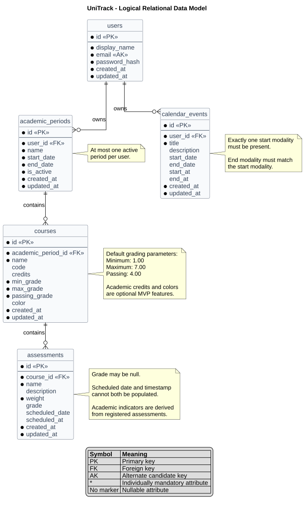

# UniTrack — Database Design

## Document Information

| Field | Value |
|---|---|
| Project | UniTrack |
| Document | Database Design |
| Version | 0.1 |
| Status | Conceptual and Logical Data Model |
| Project Phase | Phase 0 - Planning and Design |
| Target DBMS | PostgreSQL |

## 1. Introduction

### 1.1. Purpose

This document defines the database design of UniTrack.

Its purpose is to establish a consistent relational data
model that supports the approved functional requirements,
academic business rules, and use case specifications.

The database design shall provide a foundation for data
persistence, academic information management, referential
integrity, resource ownership, and reliable academic
performance calculations.

### 1.2. Scope

The database design applies to the Minimum Viable Product
defined in the Project Overview.

The model focuses on the persistent academic domain,
including:

- User accounts.
- Academic periods.
- Courses.
- Assessments.
- Custom academic events.

Technical persistence structures required by authentication,
session management, or infrastructure may be introduced
during subsequent architectural design.

### 1.3. Related Specifications

The database design is based on:

- [Project Overview](../planning/project-overview.md)
- [Software Requirements](../planning/requirements.md)
- [Business Rules](../planning/business-rules.md)
- [Use Case Model](use-cases.md)

## 2. Database Design Principles

The database design follows these principles:

- Use the relational data model.
- Achieve at least Third Normal Form.
- Preserve referential integrity.
- Minimize unnecessary data redundancy.
- Maintain explicit ownership relationships.
- Distinguish missing values from numerical zero.
- Separate authoritative data from derived indicators.
- Use precise decimal representations for academic values.
- Support schema evolution through database migrations.
- Avoid unnecessary entities outside the approved MVP scope.

The conceptual model describes domain entities and their
relationships independently of database implementation.

The logical model defines relational tables, attributes,
candidate keys, primary keys, and foreign keys.

The physical model will define PostgreSQL data types,
constraints, indexes, and transactional enforcement.

## 3. Modeling Conventions

### 3.1. Identification

| Prefix | Meaning |
|---|---|
| ENT | Domain Entity |
| REL | Entity Relationship |
| FR | Functional Requirement |
| NFR | Non-Functional Requirement |
| BR | Business Rule |
| UC | Use Case |

Entity and relationship identifiers are documentation
references rather than persisted database attributes.

### 3.2. Naming Conventions

| Element | Convention | Example |
|---|---|---|
| Table names | English, plural, snake_case | academic_periods |
| Attribute names | English, snake_case | passing_grade |
| Primary keys | id | users.id |
| Foreign keys | Referenced entity name followed by _id | course_id |
| Boolean attributes | Descriptive boolean names | is_active |
| Calendar dates | Suffix _date | start_date |
| Timestamps | Suffix _at | created_at |

### 3.3. Key Notation

| Symbol | Meaning |
|---|---|
| PK | Primary Key |
| FK | Foreign Key |
| AK | Alternate Candidate Key |
| NULL | Optional attribute value |

### 3.4. Identifier Strategy

All primary domain tables will use UUID identifiers.

Identifiers shall remain independent of descriptive names,
email addresses, academic codes, and other mutable data.

UUID values shall not be treated as authorization mechanisms.

Resource ownership must be verified independently.

The UUID generation strategy will be defined during physical
database and application design.

## 4. Domain Analysis

The database must support the six functional modules
identified during requirements analysis.

| Module | Persistence Responsibility |
|---|---|
| User Management | User identity and authentication information. |
| Academic Management | Academic periods and courses. |
| Assessment Management | Assessments, weights, grades, and scheduling information. |
| Performance Analysis | Derived calculations using academic source data. |
| Academic Calendar | Scheduled assessments and custom academic events. |
| Academic Dashboard | Consolidated information derived from the active period. |

Not every functional module requires an independent
database table.

Performance analysis and dashboard information shall be
derived from existing academic records.

## 5. Conceptual Entity Model

### 5.1. Entity Catalog

| ID | Entity | Responsibility |
|---|---|---|
| ENT-001 | User | Represents a registered account and academic data owner. |
| ENT-002 | Academic Period | Represents a user-defined academic interval. |
| ENT-003 | Course | Represents a course registered within an academic period. |
| ENT-004 | Assessment | Represents an evaluation contributing to a course grade. |
| ENT-005 | Custom Academic Event | Represents a personal calendar event independent of assessments. |

### 5.2. ENT-001 — User

The User entity represents a registered individual
interacting with UniTrack.

A user owns academic periods and custom academic events.

Conceptual attributes:

| Attribute | Required | Description |
|---|---|---|
| User identifier | Yes | Unique account identifier. |
| Display name | Yes | Name displayed within the application. |
| Email | Yes | Unique normalized account email. |
| Password hash | Yes | Secure password representation. |
| Creation timestamp | Yes | Account creation time. |
| Update timestamp | Yes | Most recent account modification time. |

Primary identifier: User identifier.

Alternate identifier: Normalized email address.

Related requirements: FR-001 to FR-007.

Related business rules: BR-001 to BR-005.

User roles are not modeled separately because the MVP
does not define distinct registered user permission roles.

### 5.3. ENT-002 — Academic Period

An Academic Period represents an academic interval
defined by a registered user.

It may represent a semester, trimester, summer period,
or another user-defined academic interval.

Conceptual attributes:

| Attribute | Required | Description |
|---|---|---|
| Period identifier | Yes | Unique academic period identifier. |
| Owner | Yes | User who owns the academic period. |
| Name | Yes | Descriptive period name. |
| Start date | Yes | First calendar date of the period. |
| End date | Yes | Last calendar date of the period. |
| Active status | Yes | Indicates the selected academic context. |
| Creation timestamp | Yes | Record creation time. |
| Update timestamp | Yes | Most recent record modification time. |

Primary identifier: Period identifier.

Related requirements: FR-008 to FR-013.

Related business rules: BR-006 to BR-013.

Academic period names do not represent unique identifiers.

Overlapping periods are permitted.

The active status represents a user-selected context
rather than a condition determined automatically by dates.

### 5.4. ENT-003 — Course

A Course represents an individual course registered
within a specific academic period.

Conceptual attributes:

| Attribute | Required | Description |
|---|---|---|
| Course identifier | Yes | Unique course identifier. |
| Academic period | Yes | Parent academic period. |
| Name | Yes | Descriptive course name. |
| Code | No | Optional academic course code. |
| Credits | No | Optional academic credit value. |
| Minimum grade | Yes | Minimum permitted grade. |
| Maximum grade | Yes | Maximum permitted grade. |
| Passing grade | Yes | Minimum final grade required to pass. |
| Color | No | Optional course display color. |
| Creation timestamp | Yes | Record creation time. |
| Update timestamp | Yes | Most recent record modification time. |

Primary identifier: Course identifier.

Related requirements: FR-014 to FR-020.

Related business rules: BR-014 to BR-020.

A course represents a period-specific academic record
rather than an institution-wide course catalog entry.

Courses with identical names or codes may exist in
different academic periods.

Course codes are not treated as unique identifiers.

Grading parameters are stored directly within each course.

Academic credits and display colors are planned optional
features and may be deferred during MVP implementation.

### 5.5. ENT-004 — Assessment

An Assessment represents an evaluation component
associated with an individual course.

Conceptual attributes:

| Attribute | Required | Description |
|---|---|---|
| Assessment identifier | Yes | Unique assessment identifier. |
| Course | Yes | Parent course. |
| Name | Yes | Assessment name. |
| Description | No | Additional assessment information. |
| Weight | Yes | Percentage contribution to the final course grade. |
| Grade | No | Current numerical assessment grade. |
| Scheduled date or timestamp | No | Scheduled academic activity or deadline. |
| Creation timestamp | Yes | Record creation time. |
| Update timestamp | Yes | Most recent record modification time. |

Primary identifier: Assessment identifier.

Related requirements: FR-021 to FR-032, FR-034.

Related business rules: BR-021 to BR-038, as applicable.

The current grade is stored directly in the assessment.

A missing grade is represented by null.

The grading status is derived from grade availability
and is not stored as an independent attribute.

An assessment may exist without a scheduled date.

### 5.6. ENT-005 — Custom Academic Event

A Custom Academic Event represents a personal calendar
item created independently of registered assessments.

Conceptual attributes:

| Attribute | Required | Description |
|---|---|---|
| Event identifier | Yes | Unique event identifier. |
| Owner | Yes | User who owns the event. |
| Title | Yes | Descriptive event title. |
| Description | No | Additional event information. |
| Start date or timestamp | Yes | Beginning of the event. |
| End date or timestamp | No | Optional ending of the event. |
| Creation timestamp | Yes | Record creation time. |
| Update timestamp | Yes | Most recent record modification time. |

Primary identifier: Event identifier.

Related requirements: FR-036, FR-037.

Related business rules: BR-003, BR-005, BR-039.

Custom academic events belong directly to users.

They do not depend on academic periods or courses.

Custom academic event functionality retains its Should
priority within the approved MVP scope.

## 6. Entity Relationships

### 6.1. Relationship Catalog

| ID | Parent Entity | Relationship | Dependent Entity |
|---|---|---|---|
| REL-001 | User | Owns | Academic Period |
| REL-002 | Academic Period | Contains | Course |
| REL-003 | Course | Contains | Assessment |
| REL-004 | User | Owns | Custom Academic Event |

### 6.2. Cardinalities

| Relationship | Parent Participation | Dependent Participation |
|---|---|---|
| REL-001 | A user owns zero or many periods. | Each period belongs to exactly one user. |
| REL-002 | A period contains zero or many courses. | Each course belongs to exactly one period. |
| REL-003 | A course contains zero or many assessments. | Each assessment belongs to exactly one course. |
| REL-004 | A user owns zero or many custom events. | Each event belongs to exactly one user. |

All dependent entities have mandatory parent relationships.

Parent entities may exist without dependent records.

### 6.3. REL-001 — User and Academic Period

Relationship type: One-to-many.

An academic period cannot exist without an owning user.

A user may have no academic periods or multiple academic
periods.

At most one academic period may be active for a user.

Related business rules: BR-006, BR-007, BR-010, BR-011.

### 6.4. REL-002 — Academic Period and Course

Relationship type: One-to-many.

A course cannot exist without an associated academic period.

An academic period may contain no courses or multiple courses.

Course ownership is inherited from the associated period.

Related business rules: BR-012, BR-014.

### 6.5. REL-003 — Course and Assessment

Relationship type: One-to-many.

An assessment cannot exist without an associated course.

A course may contain no assessments or multiple assessments.

Assessment ownership is inherited from the corresponding
course and academic period.

Related business rules: BR-020, BR-021.

### 6.6. REL-004 — User and Custom Academic Event

Relationship type: One-to-many.

A custom academic event cannot exist without an owning user.

A user may register zero or multiple custom academic events.

Custom events do not depend on academic periods or courses.

Related business rules: BR-039.

### 6.7. Conceptual Entity-Relationship Diagram

[PlantUML source](../diagrams/database/conceptual-model.puml)

## 7. Resource Ownership and Entity Lifecycle

### 7.1. Ownership Hierarchy

Academic resource ownership follows the hierarchy:

    User
      Academic Period
        Course
          Assessment

Custom academic events belong directly to the User entity.

The owner of a course is determined through its associated
academic period.

The owner of an assessment is determined through its
associated course and academic period.

Redundant user identifiers shall not be stored within
courses or assessments.

This prevents conflicting ownership information and
preserves a single authoritative ownership path.

Foreign key relationships do not replace application-level
authentication and authorization enforcement.

### 7.2. Entity Dependency

| Entity | Mandatory Parent |
|---|---|
| User | None |
| Academic Period | User |
| Course | Academic Period |
| Assessment | Course |
| Custom Academic Event | User |

### 7.3. Deletion Semantics

| Deleted Entity | Expected Domain Behavior |
|---|---|
| Academic Period | Remove its associated courses and assessments. |
| Course | Remove its associated assessments. |
| Assessment | Remove the assessment and its derived calendar information. |
| Custom Academic Event | Remove only the selected event. |
| User | Account deletion policy remains outside the current functional scope. |

Academic period and course deletion shall follow the
approved business rules for permanent dependent deletion.

Independent custom academic events shall not be removed
when a period or course is deleted.

Deletion operations affecting multiple dependent records
shall execute atomically.

The physical foreign key deletion policies will be
specified during the physical database design.

## 8. Logical Relational Model

### 8.1. Entity-to-Relation Mapping

| Entity | Relation |
|---|---|
| ENT-001 | users |
| ENT-002 | academic_periods |
| ENT-003 | courses |
| ENT-004 | assessments |
| ENT-005 | calendar_events |

One-to-many relationships are implemented logically by
placing foreign keys within their dependent relations.

No many-to-many association tables are required by the
current academic domain model.

### 8.2. Relation: users

    users (
        id PK,
        display_name,
        email AK,
        password_hash,
        created_at,
        updated_at
    )

Primary key:

- id

Alternate candidate key:

- email

The normalized email address must remain unique and
non-null.

All attributes in the current relation are mandatory.

### 8.3. Relation: academic_periods

    academic_periods (
        id PK,
        user_id FK,
        name,
        start_date,
        end_date,
        is_active,
        created_at,
        updated_at
    )

Primary key:

- id

Foreign key:

- user_id references users.id

All attributes in the current relation are mandatory.

### 8.4. Relation: courses

    courses (
        id PK,
        academic_period_id FK,
        name,
        code,
        credits,
        min_grade,
        max_grade,
        passing_grade,
        color,
        created_at,
        updated_at
    )

Primary key:

- id

Foreign key:

- academic_period_id references academic_periods.id

Nullable attributes:

- code
- credits
- color

Credits and color belong to optional MVP functionality.

### 8.5. Relation: assessments

    assessments (
        id PK,
        course_id FK,
        name,
        description,
        weight,
        grade,
        scheduled_date,
        scheduled_at,
        created_at,
        updated_at
    )

Primary key:

- id

Foreign key:

- course_id references courses.id

Nullable attributes:

- description
- grade
- scheduled_date
- scheduled_at

The scheduled date and timestamp attributes are mutually
exclusive.

Both scheduling attributes may be null.

### 8.6. Relation: calendar_events

    calendar_events (
        id PK,
        user_id FK,
        title,
        description,
        start_date,
        end_date,
        start_at,
        end_at,
        created_at,
        updated_at
    )

Primary key:

- id

Foreign key:

- user_id references users.id

Individually nullable attributes:

- description
- start_date
- end_date
- start_at
- end_at

Exactly one start modality must be provided.

The optional end modality must be consistent with
the selected start modality.

### 8.7. Logical Key Summary

| Relation | Primary Key | Foreign Keys | Alternate Key |
|---|---|---|---|
| users | id | None | email |
| academic_periods | id | user_id | None |
| courses | id | academic_period_id | None |
| assessments | id | course_id | None |
| calendar_events | id | user_id | None |

All foreign keys within the five domain relations
are mandatory.

### 8.8. Logical Model Summary

| Relation | Attributes | Primary Keys | Foreign Keys |
|---|---:|---:|---:|
| users | 6 | 1 | 0 |
| academic_periods | 8 | 1 | 1 |
| courses | 11 | 1 | 1 |
| assessments | 10 | 1 | 1 |
| calendar_events | 10 | 1 | 1 |
| **Total** | **45** | **5** | **4** |

The model contains one additional alternate candidate key.

Technical persistence relations required by authentication
or infrastructure are not included in this summary.

### 8.9. Logical Relational Diagram

[PlantUML source](../diagrams/database/relational-model.puml)

## 9. Temporal Data Modeling

### 9.1. Temporal Concepts

The academic domain distinguishes between:

- Calendar dates without a specific time.
- Timezone-aware timestamps representing specific instants.
- Missing scheduling information.

Calendar dates shall preserve their calendar-day meaning.

Timestamp-based information shall support timezone-aware
representation.

The initial presentation timezone is America/Santiago.

### 9.2. Academic Period Dates

Academic period boundaries use calendar dates.

The end date shall not precede the start date.

Academic period boundaries do not automatically restrict
the scheduling of assessments.

### 9.3. Assessment Scheduling

Assessment scheduling uses two mutually exclusive
attributes:

- scheduled_date
- scheduled_at

| scheduled_date | scheduled_at | Validity |
|---|---|---|
| Null | Null | Valid unscheduled assessment. |
| Value | Null | Valid date-only assessment. |
| Null | Value | Valid timestamp-based assessment. |
| Value | Value | Invalid scheduling state. |

A date-only assessment shall not be assigned an artificial
time merely to satisfy a timestamp representation.

### 9.4. Custom Academic Event Scheduling

Custom academic events support two temporal modalities:

1. Date-only events.
2. Timestamp-based events.

Date-only events use start_date and optionally end_date.

Timestamp-based events use start_at and optionally end_at.

The following conditions apply:

- Exactly one start modality is required.
- End values are optional.
- Start and end modalities must match.
- End values cannot precede start values.
- Date-only end dates are inclusive.
- A date-only event without an end date represents a
  single-day event.
- A timestamp-based event without an end timestamp
  represents a point-in-time event.

The temporal modality is derived from the populated fields.

### 9.5. Upcoming Assessment Semantics

Unscheduled assessments shall not be considered upcoming.

A date-only assessment is considered upcoming when its
calendar date is equal to or later than the current date
in the application presentation timezone.

A timestamp-based assessment is considered upcoming
when its scheduled instant is equal to or later than
the current instant.

Date-only assessments remain upcoming throughout their
scheduled calendar day.

Detailed ordering and API serialization conventions
will be established during API design.

## 10. Persistent and Derived Information

### 10.1. Authoritative Source Data

The database stores authoritative academic information,
including:

- Academic period information.
- Course grading configuration.
- Assessment grades and weights.
- Assessment scheduling information.
- Custom academic events.

### 10.2. Derived Academic Indicators

The following information shall be calculated from
authoritative academic data:

- Registered assessment weight.
- Graded assessment weight.
- Ungraded assessment weight.
- Unallocated assessment weight.
- Current weighted average.
- Final weighted average.
- Required passing grade.
- Minimum possible final average.
- Maximum possible final average.
- Academic status.
- Period-wide performance indicators when supported.

These values shall not be stored as independently editable
source attributes in the initial relational model.

Calculation formulas and precision policies are defined
in the Business Rules document.

### 10.3. Calendar Information

The academic calendar combines scheduled assessment
information with custom academic event information.

Scheduled assessments shall be retrieved directly from
assessment records.

They shall not be duplicated within the calendar_events
relation.

### 10.4. Dashboard Information

The academic dashboard derives information from:

- The selected active academic period.
- Courses associated with that period.
- Assessment source data.
- Academic calculation services.

A separate dashboard relation is not required.

## 11. Considered and Excluded Relations

| Potential Relation | Design Decision |
|---|---|
| grades | Current grades are stored directly in assessments. |
| grading_scales | Grading parameters are stored directly in courses. |
| subjects | No institutional course catalog is required. |
| enrollments | Courses already belong to individual academic periods. |
| academic_performance | Academic indicators are derived. |
| dashboard | Dashboard information is derived. |
| roles | Distinct registered user roles are outside the MVP. |
| universities | Institutional management is outside the MVP. |
| assessment_types | Formal assessment classifications are not required. |
| notifications | Notification functionality is outside the MVP. |
| user_sessions | Pending authentication architecture decisions. |

Excluded relations may be reconsidered if future
requirements introduce an independent persistence need.

## 12. Normalization Analysis

### 12.1. Normalization Objective

The relational model aims to reduce unnecessary data
redundancy and avoid insertion, update, and deletion
anomalies.

The analysis considers the functional dependencies
identified within the approved academic domain.

### 12.2. First Normal Form

All relations represent individual records and attributes
with scalar domain values.

Repeating collections of academic periods, courses,
assessments, and events are represented through separate
relations rather than repeating attribute groups.

The proposed relations satisfy First Normal Form.

### 12.3. Second Normal Form

The identified candidate keys of the proposed relations
consist of individual attributes.

No non-prime attribute depends on only part of a
composite candidate key.

The proposed relations satisfy Second Normal Form.

### 12.4. Third Normal Form

For each non-trivial functional dependency X -> A,
Third Normal Form requires X to be a superkey or A
to be a prime attribute.

The proposed relations avoid redundant descriptive
attributes inherited from parent entities.

Examples include:

- Period names are stored in academic_periods rather
  than courses.
- Course names are stored in courses rather than
  assessments.
- User ownership is derived through foreign key
  relationships rather than duplicated.

Under the identified functional dependencies, all
proposed relations satisfy Third Normal Form.

### 12.5. Functional Dependencies

The following notation defines the relevant functional
dependencies of each relation.

#### users

Candidate keys:

- {id}
- {email}

Functional dependencies:

    id -> display_name, email, password_hash,
          created_at, updated_at

    email -> id

The normalized email address is an alternate candidate
key and determines all user attributes.

#### academic_periods

Candidate key:

- {id}

Functional dependency:

    id -> user_id, name, start_date, end_date,
          is_active, created_at, updated_at

Period names and dates are not assumed to be unique.

The active-period constraint is a conditional uniqueness
rule rather than a candidate key of the full relation.

#### courses

Candidate key:

- {id}

Functional dependency:

    id -> academic_period_id, name, code, credits,
          min_grade, max_grade, passing_grade,
          color, created_at, updated_at

Course names and codes are not assumed to uniquely
identify course records.

Grading parameters are independently configurable
within the supported academic constraints.

#### assessments

Candidate key:

- {id}

Functional dependency:

    id -> course_id, name, description, weight,
          grade, scheduled_date, scheduled_at,
          created_at, updated_at

Assessment names are not assumed to be unique.

#### calendar_events

Candidate key:

- {id}

Functional dependency:

    id -> user_id, title, description,
          start_date, end_date, start_at, end_at,
          created_at, updated_at

Event titles and temporal values are not assumed to
uniquely identify event records.

### 12.6. Boyce-Codd Normal Form

Boyce-Codd Normal Form requires every determinant of
a non-trivial functional dependency to be a superkey.

Under the identified domain assumptions and functional
dependencies, the proposed relations satisfy BCNF.

This conclusion depends on the completeness of the
identified functional dependencies and is not guaranteed
solely by the use of surrogate UUID primary keys.

### 12.7. Normalization Summary

| Relation | 1NF | 2NF | 3NF | BCNF |
|---|---|---|---|---|
| users | Yes | Yes | Yes | Yes |
| academic_periods | Yes | Yes | Yes | Yes |
| courses | Yes | Yes | Yes | Yes |
| assessments | Yes | Yes | Yes | Yes |
| calendar_events | Yes | Yes | Yes | Yes |

The normalization result is based on the current domain
assumptions and identified functional dependencies.

Additional dependencies introduced by future requirements
must be evaluated independently.

### 12.8. Anomaly Prevention

#### Insertion Anomalies

Parent entities may exist without dependent records.

Users can create academic periods without courses,
courses without assessments, and assessments without grades.

#### Update Anomalies

Descriptive information is maintained in its authoritative
relation rather than duplicated within dependent records.

#### Deletion Anomalies

Deleting a dependent record does not remove its parent.

Parent-to-dependent deletion is intentional only where
required by approved business rules.

## 13. Preliminary Design Decisions

### 13.1. Active Academic Period

The active academic period is represented by the
is_active attribute in academic_periods.

A user may have zero or one active period.

The physical database design shall enforce this restriction
using an appropriate conditional uniqueness mechanism.

Active period replacement shall execute atomically.

### 13.2. Assessment Weight Consistency

Individual assessment weights are stored in assessments.

The total registered assessment weight of a course
shall not exceed 100%.

This is a cross-record constraint and cannot be represented
solely by an ordinary row-level CHECK constraint.

The physical and application designs shall define a
transactional enforcement strategy that remains valid
under concurrent modifications.

A redundant total weight attribute is not included
in the courses relation.

### 13.3. Grade Range Consistency

An assessment grade must respect the grading parameters
of its associated course.

Course grading configuration changes shall not invalidate
existing assessment grades.

Cross-table validation and concurrency requirements
will be addressed during physical and application design.

### 13.4. Creation and Modification Timestamps

All domain relations include creation and modification
timestamps.

These attributes provide basic record lifecycle metadata.

They do not represent a complete modification history
or auditing mechanism.

The physical schema will define their initialization
and update policies.

### 13.5. Optional Feature Persistence

The logical model includes support for:

- Academic credits.
- Course display colors.
- Custom academic events.
- Configurable grading parameters.

These structures represent the planned MVP design.

Their inclusion does not change the priority assigned
to the corresponding functional requirements.

## 14. Data Dictionary

**Status:** Pending specification.

This section will define the physical attributes of
each relation, including:

- PostgreSQL data types.
- Nullability.
- Maximum lengths.
- Default values.
- Attribute-level validation.
- Identifier generation.

## 15. Physical Database Constraints

**Status:** Pending specification.

This section will define:

- Primary key constraints.
- Foreign key constraints.
- Unique constraints.
- Check constraints.
- Conditional uniqueness.
- Referential deletion policies.
- Cross-record integrity requirements.

## 16. Indexing and Concurrency Strategy

**Status:** Pending specification.

This section will define:

- Primary and secondary indexing requirements.
- Foreign key indexes.
- Query-oriented indexes.
- Transactional integrity mechanisms.
- Concurrent assessment weight validation.
- Concurrent grading configuration validation.
- Active academic period replacement.

## 17. Physical Database Model

**Status:** Pending specification.

The physical database model will extend the logical
model with PostgreSQL-specific data types, constraints,
indexes, and implementation-oriented details.

## 18. Database Design Traceability

**Status:** Pending specification.

This section will establish detailed traceability between:

- Database relations.
- Functional requirements.
- Non-functional requirements.
- Business rules.
- Use cases.
- Physical integrity mechanisms.

## 19. Related Documentation

- [Project Overview](../planning/project-overview.md)
- [Software Requirements](../planning/requirements.md)
- [Business Rules](../planning/business-rules.md)
- [Use Case Model](use-cases.md)
- [Software Architecture](architecture.md)
- [REST API Design](api-design.md)

### References

- [PlantUML Information Engineering Diagrams](https://plantuml.com/ie-diagram)
- [PostgreSQL Constraints](https://www.postgresql.org/docs/current/ddl-constraints.html)

## 20. Document Status

This document establishes the initial conceptual and
logical database design of UniTrack.

The current academic domain model defines:

- Five domain entities.
- Four entity relationships.
- Five logical relations.
- Forty-five logical attributes.
- Five primary keys.
- Four foreign keys.
- One alternate candidate key.

The proposed relational model satisfies at least Third
Normal Form and satisfies BCNF under the identified
functional dependencies.

The physical data dictionary, PostgreSQL constraints,
indexing strategy, concurrency mechanisms, and detailed
database design traceability remain pending.

**Conceptual design status:** Initial specification complete.

**Logical design status:** Initial specification complete.

**Physical design status:** Pending.

**Database implementation status:** Not started.
