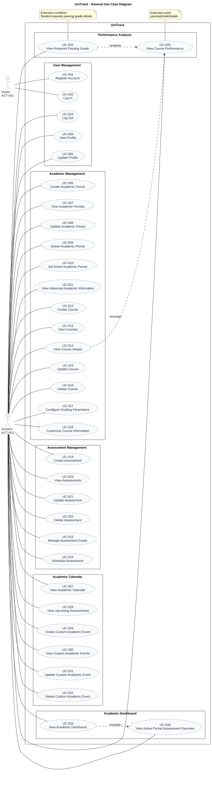
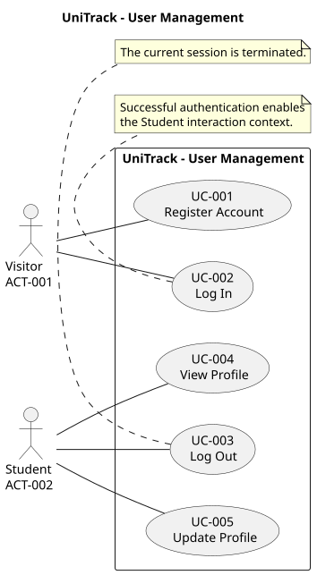
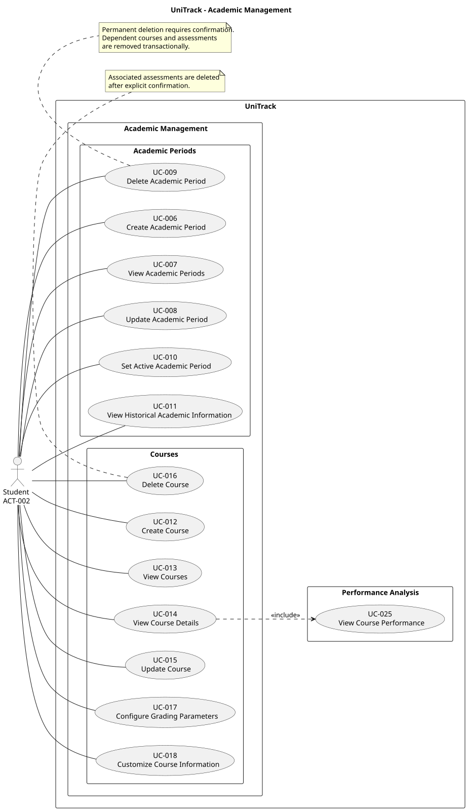
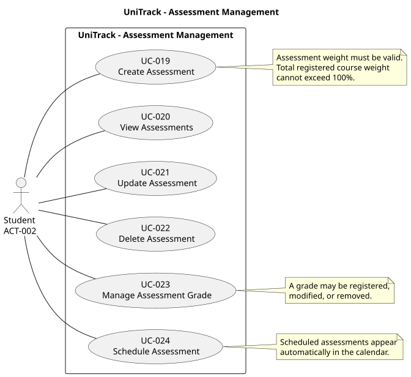
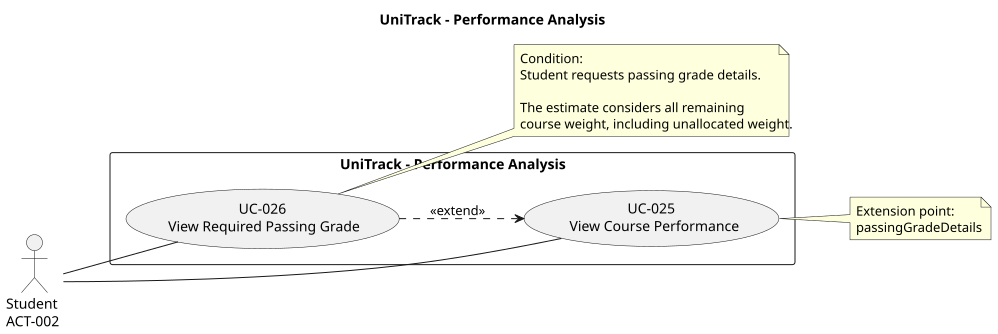
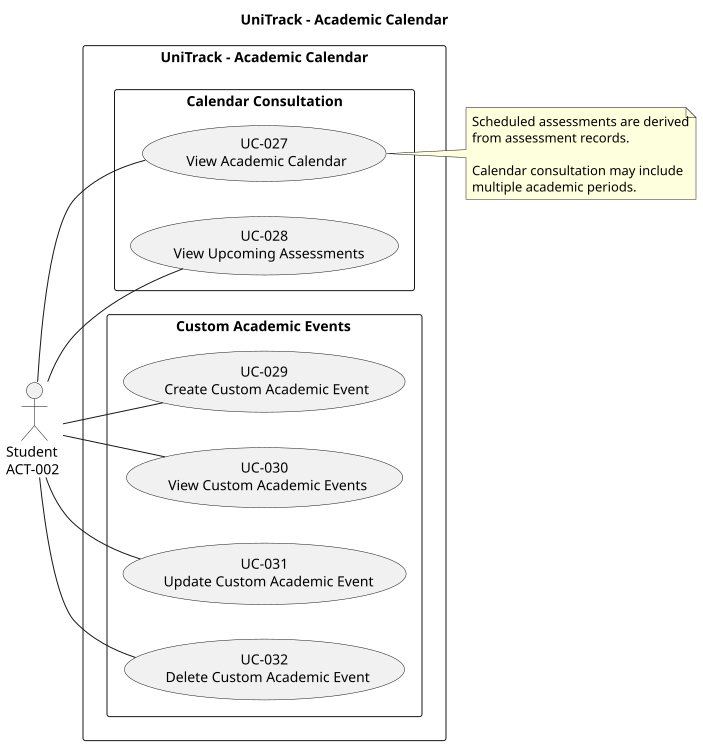
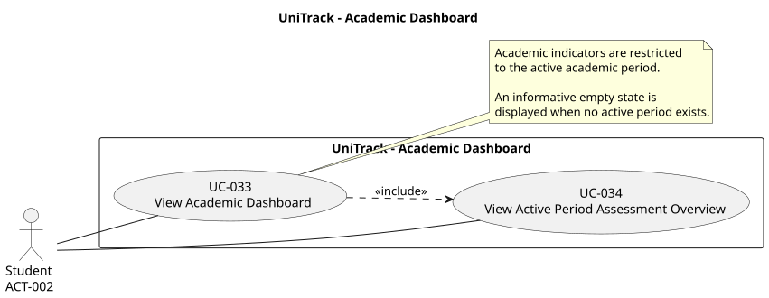

# UniTrack — Use Case Model

## Document Information

| Field | Value |
|---|---|
| Project | UniTrack |
| Document | Use Case Model |
| Version | 1.0 |
| Status | Initial Functional Model Specification |
| Project Phase | Phase 0 - Planning and Design |

## 1. Introduction

### 1.1. Purpose

This document defines the functional interaction model of
UniTrack from the perspective of its external actors.

Its purpose is to identify the actors that interact with
the application, establish their responsibilities and
access boundaries, and describe the use cases through
which they achieve their academic management objectives.

The use case model provides a connection between software
requirements, business rules, system design, implementation,
and functional verification.

### 1.2. Scope

This document applies to the Minimum Viable Product
defined in the [Project Overview](../planning/project-overview.md).

The functional model is based on the requirements and
business rules established in the following documents:

- [Software Requirements Specification](../planning/requirements.md)
- [Business Rules](../planning/business-rules.md)

Features excluded from the MVP are not represented as
active use cases.

### 1.3. Intended Audience

This document is intended for developers, testers,
contributors, and reviewers involved in the development
and verification of UniTrack.

## 2. Functional Modeling Conventions

### 2.1. Modeling Terminology

| Element | Definition |
|---|---|
| Actor | An external role that interacts with the system. |
| Use Case | A system interaction through which an actor achieves an identifiable objective. |
| Primary Actor | An actor that initiates or pursues a goal through a use case. |
| Supporting Actor | An external actor that provides assistance or services to the system during a use case. |
| System Boundary | The conceptual boundary separating the system from its external environment. |
| Functional Requirement | A capability or behavior that the system shall provide. |
| Business Rule | A condition or restriction governing domain behavior. |
| Preconditions | Conditions that must hold before a use case can begin successfully. |
| Postconditions | Conditions that hold after a use case has completed. |

### 2.2. Identification Convention

| Prefix | Meaning | Example |
|---|---|---|
| ACT | Actor | ACT-001 |
| UC | Use Case | UC-001 |
| FR | Functional Requirement | FR-001 |
| NFR | Non-Functional Requirement | NFR-001 |
| BR | Business Rule | BR-001 |

Actor and use case identifiers should remain stable
throughout the development lifecycle.

Use case identifiers are independent of functional
requirement identifiers.

A use case may satisfy multiple functional requirements,
and a functional requirement may participate in multiple
use cases.

### 2.3. Use Case Naming

Use case names shall:

- Be written in English.
- Begin with an action verb.
- Represent an identifiable actor objective.
- Avoid unnecessary implementation details.
- Remain consistent with project terminology.

### 2.4. Priority Classification

Use cases inherit their priorities from the associated
functional requirements.

| Priority | Description |
|---|---|
| Must | Mandatory functionality required for MVP completion. |
| Should | Important functionality that may be deferred. |
| Could | Optional functionality depending on available resources. |
| Won't | Functionality excluded from the current release. |

Excluded functionality is not included in the active
use case catalog.

## 3. System Boundary

UniTrack is modeled as a single software system.

The system boundary includes:

- The web-based user interface.
- Authentication and authorization mechanisms.
- Application services.
- Academic management functionality.
- Academic calculation services.
- Calendar and dashboard functionality.
- Data persistence and database management.

Internal technical components, including React, FastAPI,
PostgreSQL, and application services, are not considered
external actors.

The functional model describes the observable behavior
of the application rather than its internal technical
architecture.

## 4. Actor Identification

### 4.1. Actor Catalog

| ID | Actor | Type | Authentication State |
|---|---|---|---|
| ACT-001 | Visitor | Primary | Unauthenticated |
| ACT-002 | Student | Primary | Authenticated |

The initial version of UniTrack does not require
supporting external actors.

### 4.2. ACT-001 — Visitor

| Attribute | Description |
|---|---|
| Identifier | ACT-001 |
| Name | Visitor |
| Type | Primary Actor |
| Authentication State | Unauthenticated |
| Primary Objective | Create an account or obtain authenticated access. |
| Access Scope | Public application functionality. |
| Related Requirements | FR-001, FR-002, FR-006 |
| Related Business Rules | BR-001, BR-002, BR-004 |

#### Description

The Visitor represents an individual interacting with
UniTrack without an active authenticated session.

A visitor may be a new individual who intends to create
an account or an existing registered user who has not
yet authenticated.

#### Responsibilities

- Provide valid registration information.
- Provide authentication credentials.
- Interact with publicly available functionality.
- Authenticate before accessing private functionality.

#### Permissions

The Visitor may:

- Access public application pages.
- Register a new account.
- Authenticate using existing account credentials.

#### Restrictions

The Visitor shall not:

- Access private academic resources.
- Create or modify protected academic information.
- Consult personal academic performance indicators.
- Access another user's private information.

### 4.3. ACT-002 — Student

| Attribute | Description |
|---|---|
| Identifier | ACT-002 |
| Name | Student |
| Type | Primary Actor |
| Authentication State | Authenticated |
| Primary Objective | Organize academic information and monitor academic performance. |
| Access Scope | Personal academic resources and protected application functionality. |
| Related Requirements | FR-003 to FR-040, as applicable. |
| Related Business Rules | BR-003 to BR-040, as applicable. |

#### Description

The Student represents a registered and authenticated
user who manages personal academic information within
UniTrack.

The Student is the primary consumer of the academic
management, assessment, performance analysis, calendar,
and dashboard functionality.

#### Responsibilities

- Maintain personal account information.
- Register and manage academic periods.
- Register and manage courses.
- Register assessments, grades, and weights.
- Maintain accurate academic information.
- Configure supported grading parameters.
- Consult academic performance indicators.
- Organize academic responsibilities.
- Confirm operations involving permanent data deletion.

#### Permissions

The Student may:

- Consult and modify supported personal profile information.
- Manage owned academic periods.
- Manage courses associated with owned academic periods.
- Manage assessments associated with owned courses.
- Consult calculated academic performance information.
- Access the personal academic calendar.
- Manage custom academic events when supported.
- Consult the academic dashboard.
- Terminate the current authenticated session.

#### Restrictions

The Student shall not:

- Access academic resources belonging to other users.
- Modify or delete resources belonging to other users.
- Bypass academic validation rules.
- Access administrative or institutional functionality.
- Modify calculated academic indicators independently
  of their underlying source information.

### 4.4. Actor Relationships

The Visitor and Student represent different interaction
roles rather than necessarily different individuals.

An individual may interact with the system as a Visitor
before authentication and subsequently as a Student
after successful authentication.

Logging out or expiration of the authenticated session
returns the individual to the unauthenticated interaction
context.

The actor model does not define a UML generalization
relationship between Visitor and Student.

Their available interactions depend on their respective
authentication states and responsibilities.

### 4.5. Excluded Actors

| Potential Actor or Component | Reason for Exclusion |
|---|---|
| Administrator | No administrative product functionality is included in the MVP. |
| Instructor | Teaching and institutional grading functionality is excluded. |
| University Staff | Institutional management functionality is excluded. |
| External Calendar Service | External calendar synchronization is outside the MVP. |
| Email Service | Email notifications and password recovery are excluded. |
| External Identity Provider | Third-party authentication is excluded. |
| Artificial Intelligence Service | Artificial intelligence functionality is excluded. |
| Database | Represents an internal system component. |
| Frontend | Represents an internal system component. |
| Backend | Represents an internal system component. |
| System Clock | Date and time retrieval does not represent an independent external interaction goal. |

Excluded actors may be reconsidered if future versions
introduce functionality requiring their participation.

## 5. Use Case Identification

### 5.1. Identification Approach

Use cases are derived from the approved project scope,
functional requirements, and academic business rules.

A use case shall represent an identifiable objective
pursued by an external actor.

Internal operations, including data validation, access
control, academic calculations, and persistence, are not
automatically represented as independent use cases.

The model uses separate use cases for operations with
distinct actor objectives or materially different
business conditions.

Closely related operations may be grouped when they
represent a common actor objective.

The identified use cases are organized into six functional
modules:

1. User Management.
2. Academic Management.
3. Assessment Management.
4. Performance Analysis.
5. Academic Calendar.
6. Academic Dashboard.

Functional modules represent logical groupings and do not
necessarily correspond to independently deployed services
or individual user interface pages.

## 6. Use Case Catalog

### 6.1. User Management

| ID | Use Case | Primary Actor | Priority | Related Requirements |
|---|---|---|---|---|
| UC-001 | Register Account | Visitor | Must | FR-001 |
| UC-002 | Log In | Visitor | Must | FR-002 |
| UC-003 | Log Out | Student | Must | FR-003 |
| UC-004 | View Profile | Student | Should | FR-004 |
| UC-005 | Update Profile | Student | Should | FR-005 |

#### Use Case Objectives

| ID | Objective |
|---|---|
| UC-001 | Create a personal UniTrack account. |
| UC-002 | Obtain authenticated access to private functionality. |
| UC-003 | Terminate the current authenticated session. |
| UC-004 | Consult personal profile information. |
| UC-005 | Modify the supported personal profile information. |

Authentication enforcement and resource ownership
verification are cross-cutting requirements rather than
independent actor objectives.

### 6.2. Academic Management

| ID | Use Case | Primary Actor | Priority | Related Requirements |
|---|---|---|---|---|
| UC-006 | Create Academic Period | Student | Must | FR-008 |
| UC-007 | View Academic Periods | Student | Must | FR-009 |
| UC-008 | Update Academic Period | Student | Must | FR-010 |
| UC-009 | Delete Academic Period | Student | Must | FR-011 |
| UC-010 | Set Active Academic Period | Student | Must | FR-012 |
| UC-011 | View Historical Academic Information | Student | Should | FR-013 |
| UC-012 | Create Course | Student | Must | FR-014 |
| UC-013 | View Courses | Student | Must | FR-015 |
| UC-014 | View Course Details | Student | Must | FR-015 |
| UC-015 | Update Course | Student | Must | FR-016 |
| UC-016 | Delete Course | Student | Must | FR-017 |
| UC-017 | Configure Grading Parameters | Student | Should | FR-018 |
| UC-018 | Customize Course Information | Student | Could | FR-019, FR-020 |

#### Use Case Objectives

| ID | Objective |
|---|---|
| UC-006 | Register a new academic period. |
| UC-007 | Consult registered academic periods. |
| UC-008 | Modify existing academic period information. |
| UC-009 | Delete an academic period and its dependent academic resources. |
| UC-010 | Select an academic period as the active academic context. |
| UC-011 | Consult academic information from previous periods. |
| UC-012 | Register a course within an academic period. |
| UC-013 | Consult courses associated with an academic period. |
| UC-014 | Consult detailed information about a specific course. |
| UC-015 | Modify basic course information. |
| UC-016 | Delete a course and its associated assessments. |
| UC-017 | Configure the grading scale and passing grade of a course. |
| UC-018 | Manage optional academic credits and course display colors. |

Course list consultation and individual course detail
consultation are represented as distinct actor objectives.

Grading parameter configuration is separated from general
course modification because it is subject to specific
academic validation rules.

Optional course credits and display colors are grouped
into a single customization use case.

Historical academic information may be modified through
the existing academic resource management use cases.

### 6.3. Assessment Management

| ID | Use Case | Primary Actor | Priority | Related Requirements |
|---|---|---|---|---|
| UC-019 | Create Assessment | Student | Must | FR-021, FR-025 |
| UC-020 | View Assessments | Student | Must | FR-022 |
| UC-021 | Update Assessment | Student | Must | FR-023, FR-025 |
| UC-022 | Delete Assessment | Student | Must | FR-024 |
| UC-023 | Manage Assessment Grade | Student | Must | FR-026 |
| UC-024 | Schedule Assessment | Student | Must | FR-027 |

#### Use Case Objectives

| ID | Objective |
|---|---|
| UC-019 | Register an assessment and its corresponding weight. |
| UC-020 | Consult assessments associated with a course. |
| UC-021 | Modify assessment information and weights. |
| UC-022 | Delete a registered assessment. |
| UC-023 | Register, modify, or remove an assessment grade. |
| UC-024 | Assign, modify, or remove an assessment's scheduled date. |

Grade management and assessment scheduling are identified
as separate use cases because they represent recurring
academic activities performed after assessment creation.

Grades and scheduled dates may also be provided during
assessment creation when supported.

Weight validation is a mandatory behavior of assessment
creation and modification rather than an independent
actor objective.

### 6.4. Performance Analysis

| ID | Use Case | Primary Actor | Priority | Related Requirements |
|---|---|---|---|---|
| UC-025 | View Course Performance | Student | Must | FR-028, FR-029, FR-030, FR-032 |
| UC-026 | View Required Passing Grade | Student | Must | FR-031, FR-032 |

#### Use Case Objectives

| ID | Objective |
|---|---|
| UC-025 | Consult current and final averages, assessment weight progress, and calculated academic status. |
| UC-026 | Consult the estimated weighted average required to pass a course and its passing feasibility. |

Academic performance indicators are calculated automatically
from the underlying academic information.

Individual calculation algorithms are not represented
as independent actor objectives.

Academic calculation behavior shall follow the policies
defined in the Business Rules document.

### 6.5. Academic Calendar

| ID | Use Case | Primary Actor | Priority | Related Requirements |
|---|---|---|---|---|
| UC-027 | View Academic Calendar | Student | Must | FR-033, FR-034 |
| UC-028 | View Upcoming Assessments | Student | Must | FR-035 |
| UC-029 | Create Custom Academic Event | Student | Should | FR-036 |
| UC-030 | View Custom Academic Events | Student | Should | FR-036 |
| UC-031 | Update Custom Academic Event | Student | Should | FR-037 |
| UC-032 | Delete Custom Academic Event | Student | Should | FR-037 |

#### Use Case Objectives

| ID | Objective |
|---|---|
| UC-027 | Consult the monthly academic calendar and navigate between months. |
| UC-028 | Consult upcoming assessments and submission deadlines. |
| UC-029 | Register a custom academic event. |
| UC-030 | Consult registered custom events and their details. |
| UC-031 | Modify an existing custom academic event. |
| UC-032 | Delete a registered custom academic event. |

Assessment calendar integration represents automatic
system behavior associated with calendar consultation.

The academic calendar may include authorized assessments
from multiple academic periods.

Custom academic events remain independent of registered
assessments and academic periods.

### 6.6. Academic Dashboard

| ID | Use Case | Primary Actor | Priority | Related Requirements |
|---|---|---|---|---|
| UC-033 | View Academic Dashboard | Student | Must | FR-038, FR-039 |
| UC-034 | View Active Period Assessment Overview | Student | Must | FR-040 |

#### Use Case Objectives

| ID | Objective |
|---|---|
| UC-033 | Consult a consolidated overview of the active academic period and its performance indicators. |
| UC-034 | Consult upcoming and ungraded assessments belonging to the active academic period. |

The dashboard uses the active academic period as its
primary academic context.

Unlike the general academic calendar, dashboard assessment
information is restricted to the selected active period.

Dashboard and calendar use cases may reuse underlying
application services without duplicating business logic.

## 7. Cross-Cutting Functional Requirements

The following functional requirements apply across
protected application functionality.

| Requirement | Description | Applicability |
|---|---|---|
| FR-006 | Protected functionality | All use cases requiring an authenticated actor. |
| FR-007 | Resource ownership enforcement | All use cases that access or modify protected user resources. |

These requirements shall be considered during detailed
use case specification.

They do not represent independent actor objectives.

Other functional requirements may describe mandatory
internal behavior within one or more use cases.

Examples include:

- Assessment weight validation.
- Grade range validation.
- Academic performance calculations.
- Automatic calendar integration.
- Academic status determination.

These behaviors shall remain traceable to their
associated functional requirements and business rules.

## 8. Use Case Summary

### 8.1. Distribution by Functional Module

| Module | Must | Should | Could | Total |
|---|---:|---:|---:|---:|
| User Management | 3 | 2 | 0 | 5 |
| Academic Management | 10 | 2 | 1 | 13 |
| Assessment Management | 6 | 0 | 0 | 6 |
| Performance Analysis | 2 | 0 | 0 | 2 |
| Academic Calendar | 2 | 4 | 0 | 6 |
| Academic Dashboard | 2 | 0 | 0 | 2 |
| **Total** | **25** | **8** | **1** | **34** |

### 8.2. Distribution by Actor

| Actor | Total Use Cases |
|---|---:|
| Visitor | 2 |
| Student | 32 |
| **Total** | **34** |

### 8.3. Functional Requirement Coverage

| Module | Defined Requirements | Covered Requirements |
|---|---:|---:|
| User Management | 7 | 7 |
| Academic Management | 13 | 13 |
| Assessment Management | 7 | 7 |
| Performance Analysis | 5 | 5 |
| Academic Calendar | 5 | 5 |
| Academic Dashboard | 3 | 3 |
| **Total** | **40** | **40** |

All functional requirements are associated with one or
more use cases or identified as cross-cutting requirements.

This coverage represents specification traceability
rather than implementation or test completion.

## 9. Use Case Relationships and Diagrams

### 9.1. Modeling Approach

The UniTrack use case model represents the observable
interactions between external actors and the application.

The model preserves the 34 use cases identified in the
use case catalog.

Use cases are organized into functional packages to improve
readability and maintain consistency with the software
requirements specification.

The model does not represent internal software components
as external actors.

### 9.2. Actor Associations

The Visitor is directly associated with the following use cases:

- UC-001: Register Account.
- UC-002: Log In.

The Student is directly associated with UC-003 through UC-034.

Authentication and resource ownership verification are
cross-cutting conditions rather than independent use cases.

No actor generalization relationship is defined.

### 9.3. Include Relationships

| Base Use Case | Included Use Case | Justification |
|---|---|---|
| UC-014 | UC-025 | Course details always incorporate the available academic performance information. |
| UC-033 | UC-034 | The dashboard always incorporates the assessment overview or its corresponding empty state. |

An included use case is executed as part of the behavior
of its base use case.

### 9.4. Extend Relationships

| Extending Use Case | Base Use Case | Extension Point | Condition |
|---|---|---|---|
| UC-026 | UC-025 | passingGradeDetails | The Student requests detailed passing grade information. |

The base performance consultation remains meaningful
without execution of its extension.

When requested, the extension shall provide the required
grade estimation, passing feasibility information, or an
explanation that no remaining course weight exists.

This relationship does not change the mandatory priority
of the required grade estimation feature.

### 9.5. Relationship Constraints

The model shall not use include or extend relationships
solely to represent:

- Authentication preconditions.
- User interface navigation sequences.
- Shared implementation code.
- Feature priority classifications.
- Internal data validation.
- Database persistence operations.

### 9.6. General Use Case Diagram

The following diagram represents the complete functional
scope of UniTrack.

[PlantUML source](../diagrams/use-cases/general.puml)

### 9.7. Functional Module Diagrams

#### User Management

[PlantUML source](../diagrams/use-cases/user-management.puml)

#### Academic Management

[PlantUML source](../diagrams/use-cases/academic-management.puml)

#### Assessment Management

[PlantUML source](../diagrams/use-cases/assessment-management.puml)

#### Performance Analysis

[PlantUML source](../diagrams/use-cases/performance-analysis.puml)

#### Academic Calendar

[PlantUML source](../diagrams/use-cases/academic-calendar.puml)

#### Academic Dashboard

[PlantUML source](../diagrams/use-cases/academic-dashboard.puml)

### 9.8. Diagram Maintenance

PlantUML source files are the authoritative editable
representation of the UML diagrams.

SVG files are generated visual representations intended
for documentation and review.

Changes to actors, use cases, or UML relationships shall
be reflected in both the source files and the corresponding
generated diagrams.

Use case identifiers shall remain consistent across the
catalog, diagrams, detailed specifications, and traceability
matrix.

## 10. Detailed Use Case Specifications

### 10.1. Specification Conventions

Each use case specification defines:

- Identifier and name.
- Primary actor.
- Priority.
- Objective.
- Trigger.
- Preconditions.
- Successful postconditions.
- Failure postconditions.
- Main success scenario.
- Alternative flows.
- Exception flows.
- Related functional requirements.
- Applicable non-functional requirements.
- Applicable business rules.

The detailed traceability matrix in Section 11 supplements
the requirement references included in each specification.

### 10.2. Common Interaction Conditions

| ID | Condition |
|---|---|
| CC-001 | Protected functionality requires a valid authenticated session. |
| CC-002 | Access to academic resources requires verified ownership. |
| CC-003 | Submitted information must satisfy applicable validation rules. |
| CC-004 | Failed operations must not produce partial persisted changes. |
| CC-005 | Error messages must not expose sensitive or internal information. |
| CC-006 | Permanent deletion requires explicit user confirmation. |
| CC-007 | Academic changes must be reflected in affected derived indicators. |
| CC-008 | Should and Could functionality is applicable when implemented. |

Conditions CC-001 and CC-002 apply to protected use cases
according to the resources involved.

Conditions CC-003 through CC-007 apply when relevant to
the interaction.

These conditions summarize existing requirements and business
rules rather than introduce new product requirements.

### 10.3. Common Exception Handling

The following exception scenarios apply throughout the
functional model.

#### CE-01 — Invalid or Expired Authentication

The system rejects the protected operation and requires
the user to authenticate again.

No unauthorized information is returned or modified.

#### CE-02 — Unauthorized or Unavailable Resource

The system rejects the operation when the requested resource
does not exist or is not accessible to the authenticated user.

The response shall not disclose another user's private data.

#### CE-03 — Invalid Input

The system identifies invalid or missing information and
rejects the submitted operation.

The user may correct the information and retry.

#### CE-04 — Operation Failure

The system reports that the operation could not be completed.

Incomplete transactional changes are rolled back.

Internal implementation details are not disclosed.

#### CE-05 — Concurrent Data Conflict

The system validates applicable business conditions against
the current persisted state.

An operation that would violate a business rule is rejected.

The user may retrieve updated information and retry.

### 10.4. Common Alternative Flows

#### CA-01 — Cancel Operation

The user cancels an operation before confirmation or submission.

No requested data modification is performed.

#### CA-02 — Empty Result

A valid consultation returns no matching records.

The system presents an informative empty state rather than
classifying the absence of records as an application error.

### 10.5. Failure Postconditions

Unless explicitly stated otherwise:

- Failed mutations do not introduce partial persisted changes.
- Failed consultations do not expose unauthorized information.
- Existing academic data remains unchanged by rejected
  operations.
- Errors are communicated according to NFR-016.

### 10.6. User Management

#### UC-001 — Register Account

| Attribute | Value |
|---|---|
| Primary Actor | Visitor |
| Priority | Must |
| Objective | Create a personal UniTrack account. |
| Trigger | The Visitor selects account registration. |
| Preconditions | No authenticated session is required. |
| Success Postconditions | A new account exists with securely stored authentication information. |
| Failure Postconditions | No incomplete account is created. |
| Functional Requirements | FR-001 |
| Business Rules | BR-001, BR-002 |

**Main Success Scenario**

1. The Visitor requests the registration form.
2. The system presents the required registration fields.
3. The Visitor provides a name, email address, and password.
4. The Visitor submits the information.
5. The system validates and normalizes the submitted data.
6. The system verifies email uniqueness.
7. The system securely hashes the password.
8. The system creates the account.
9. The system confirms registration and provides access
   to the login functionality.

**Alternative Flows**

- A1: The Visitor cancels registration before submission.
  Apply CA-01.
- A2: Surrounding whitespace or uppercase characters in
  the email are normalized according to BR-002.

**Exception Flows**

- E1: Required or invalid information is submitted.
  Apply CE-03.
- E2: The normalized email is already registered.
  Registration is rejected.
- E3: Account creation fails. Apply CE-04.

---

#### UC-002 — Log In

| Attribute | Value |
|---|---|
| Primary Actor | Visitor |
| Priority | Must |
| Objective | Obtain authenticated access. |
| Trigger | The Visitor requests login. |
| Preconditions | A registered account exists for successful authentication. |
| Success Postconditions | A valid authenticated session is established. |
| Failure Postconditions | No authenticated session is granted by the failed attempt. |
| Functional Requirements | FR-002 |
| Business Rules | BR-002, BR-004 |

**Main Success Scenario**

1. The Visitor requests the login functionality.
2. The system presents the authentication form.
3. The Visitor provides an email address and password.
4. The system normalizes the email address.
5. The system validates the credentials.
6. The system establishes an authenticated session.
7. The user enters the Student interaction context.
8. The system provides access to the academic dashboard.

**Alternative Flows**

- A1: The authenticated user has no active academic period.
  The dashboard presents its corresponding empty state.

**Exception Flows**

- E1: Credentials are invalid. Authentication is rejected
  using a generic failure message.
- E2: Required credentials are missing. Apply CE-03.
- E3: Authentication attempt restrictions are reached.
  The system temporarily restricts further attempts.
- E4: Session establishment fails. Apply CE-04.

---

#### UC-003 — Log Out

| Attribute | Value |
|---|---|
| Primary Actor | Student |
| Priority | Must |
| Objective | Terminate the current authenticated session. |
| Trigger | The Student selects logout. |
| Preconditions | An authenticated session exists. |
| Success Postconditions | The current session is terminated and local authentication state is cleared. |
| Failure Postconditions | Successful server-side termination is not claimed unless confirmed. |
| Functional Requirements | FR-003, FR-006 |
| Business Rules | BR-004 |

**Main Success Scenario**

1. The Student requests logout.
2. The system invalidates the current authenticated session.
3. The system clears client-side authentication state.
4. The system returns the user to the public context.
5. Subsequent protected access requires authentication.

**Alternative Flows**

- A1: The session has already expired. The system clears
  local authentication state and returns to the public context.

**Exception Flows**

- E1: Server-side session termination cannot be confirmed.
  The system clears local authentication state and reports
  that remote termination could not be confirmed.
- E2: Subsequent requests using a terminated session
  are rejected.

---

#### UC-004 — View Profile

| Attribute | Value |
|---|---|
| Primary Actor | Student |
| Priority | Should |
| Objective | Consult personal profile information. |
| Trigger | The Student opens the profile section. |
| Preconditions | CC-001 and CC-002 apply. |
| Success Postconditions | Supported profile information is displayed. |
| Failure Postconditions | No unauthorized information is disclosed. |
| Functional Requirements | FR-004 |
| Business Rules | BR-003, BR-004, BR-005 |

**Main Success Scenario**

1. The Student requests personal profile information.
2. The system identifies the authenticated user.
3. The system retrieves the supported profile fields.
4. The system presents the profile without sensitive
   authentication information.

**Alternative Flows**

- A1: Optional profile information is absent. The system
  displays the available information.

**Exception Flows**

- E1: Authentication is invalid. Apply CE-01.
- E2: Profile retrieval fails. Apply CE-04.

---

#### UC-005 — Update Profile

| Attribute | Value |
|---|---|
| Primary Actor | Student |
| Priority | Should |
| Objective | Modify the personal display name. |
| Trigger | The Student requests profile modification. |
| Preconditions | CC-001 and CC-002 apply. |
| Success Postconditions | The valid display name is persisted. |
| Failure Postconditions | Existing profile information remains unchanged. |
| Functional Requirements | FR-005 |
| Business Rules | BR-003, BR-004, BR-005 |

**Main Success Scenario**

1. The Student requests profile modification.
2. The system presents the current editable information.
3. The Student provides a new display name.
4. The system validates the submitted value.
5. The system persists the modification.
6. The system displays the updated profile.

**Alternative Flows**

- A1: The Student cancels the modification. Apply CA-01.
- A2: The submitted display name is unchanged. The existing
  profile remains valid without requiring a data modification.

**Exception Flows**

- E1: The display name is empty or invalid. Apply CE-03.
- E2: An unauthorized modification is requested. Apply CE-02.
- E3: Persistence fails. Apply CE-04.

Email address modification is outside this use case.

### 10.7. Academic Management

#### UC-006 — Create Academic Period

| Attribute | Value |
|---|---|
| Primary Actor | Student |
| Priority | Must |
| Objective | Register a new academic period. |
| Trigger | The Student requests period creation. |
| Preconditions | CC-001 applies. |
| Success Postconditions | A new period belongs to the authenticated user. |
| Failure Postconditions | No incomplete period is created. |
| Functional Requirements | FR-008 |
| Business Rules | BR-006 to BR-010 |

**Main Success Scenario**

1. The Student requests academic period creation.
2. The system presents the required fields.
3. The Student provides a name, start date, and end date.
4. The system validates the name and date range.
5. The system associates the period with the authenticated user.
6. The system creates the period as inactive.
7. The system confirms creation.

**Alternative Flows**

- A1: The period dates overlap another registered period.
  Creation remains permitted.
- A2: The Student cancels creation. Apply CA-01.

**Exception Flows**

- E1: Required information is invalid. Apply CE-03.
- E2: The end date precedes the start date. Creation is rejected.
- E3: Persistence fails. Apply CE-04.

Period activation is handled independently by UC-010.

---

#### UC-007 — View Academic Periods

| Attribute | Value |
|---|---|
| Primary Actor | Student |
| Priority | Must |
| Objective | Consult registered academic periods. |
| Trigger | The Student opens period management. |
| Preconditions | CC-001 applies. |
| Success Postconditions | Owned periods and their active states are displayed. |
| Failure Postconditions | No unauthorized information is disclosed. |
| Functional Requirements | FR-009 |
| Business Rules | BR-003, BR-006, BR-007, BR-010 |

**Main Success Scenario**

1. The Student requests the academic period list.
2. The system identifies the authenticated user.
3. The system retrieves the user's academic periods.
4. The system displays their names, dates, and active states.

**Alternative Flows**

- A1: No periods exist. Apply CA-02 and provide access
  to period creation.
- A2: No active period exists. The list remains available.

**Exception Flows**

- E1: Authentication is invalid. Apply CE-01.
- E2: Period retrieval fails. Apply CE-04.

---

#### UC-008 — Update Academic Period

| Attribute | Value |
|---|---|
| Primary Actor | Student |
| Priority | Must |
| Objective | Modify an existing academic period. |
| Trigger | The Student requests period modification. |
| Preconditions | A selected owned period exists. |
| Success Postconditions | Valid period information is updated. |
| Failure Postconditions | Existing period information remains unchanged. |
| Functional Requirements | FR-010 |
| Business Rules | BR-006, BR-008, BR-009, BR-013 |

**Main Success Scenario**

1. The Student selects an academic period.
2. The system verifies ownership.
3. The system presents its current information.
4. The Student modifies the name or dates.
5. The system validates the submitted information.
6. The system persists the valid modifications.
7. The system displays the updated period.

**Alternative Flows**

- A1: An inactive or historical period is selected.
  Modification remains permitted.
- A2: The Student cancels modification. Apply CA-01.

**Exception Flows**

- E1: The period is unavailable or unauthorized. Apply CE-02.
- E2: The submitted date range is invalid. Apply CE-03.
- E3: Persistence fails. Apply CE-04.

Associated assessment dates are not automatically modified.

---

#### UC-009 — Delete Academic Period

| Attribute | Value |
|---|---|
| Primary Actor | Student |
| Priority | Must |
| Objective | Permanently remove a period and its dependent academic data. |
| Trigger | The Student requests period deletion. |
| Preconditions | An owned academic period exists. |
| Success Postconditions | The period, its courses, and their assessments are deleted. |
| Failure Postconditions | No partial deletion occurs. |
| Functional Requirements | FR-011 |
| Business Rules | BR-012, BR-020, BR-038, BR-040 |

**Main Success Scenario**

1. The Student selects an academic period for deletion.
2. The system verifies ownership.
3. The system identifies the dependent courses and assessments.
4. The system informs the Student about permanent data loss.
5. The Student explicitly confirms deletion.
6. The system deletes the period and dependent academic data
   within an atomic operation.
7. The system updates affected calendar and dashboard information.
8. The system confirms successful deletion.

**Alternative Flows**

- A1: The Student rejects the confirmation. Apply CA-01.
- A2: The deleted period was active. No active period remains.
- A3: The period contains no courses. Only the period is deleted.

**Exception Flows**

- E1: Ownership verification fails. Apply CE-02.
- E2: The dependent data changes in a way that invalidates
  the deletion confirmation. Refresh the information and
  request confirmation again.
- E3: Deletion fails. Apply CE-04.

Independent custom academic events remain unaffected.

---

#### UC-010 — Set Active Academic Period

| Attribute | Value |
|---|---|
| Primary Actor | Student |
| Priority | Must |
| Objective | Select the default academic context. |
| Trigger | The Student requests period activation. |
| Preconditions | An owned academic period exists. |
| Success Postconditions | Exactly the selected period is active for the user. |
| Failure Postconditions | The previous active-period state is preserved. |
| Functional Requirements | FR-012 |
| Business Rules | BR-010, BR-011, BR-040 |

**Main Success Scenario**

1. The Student selects an academic period.
2. The system verifies ownership.
3. The system identifies the currently active period, if any.
4. The system atomically deactivates the previous period
   and activates the selected period.
5. The system updates the default academic context.
6. The system confirms the selected period.

**Alternative Flows**

- A1: No previously active period exists. Only the selected
  period needs to be activated.
- A2: The selected period is already active. The existing
  state remains unchanged.

**Exception Flows**

- E1: The requested period is unauthorized or unavailable.
  Apply CE-02.
- E2: A concurrent operation prevents a valid transition.
  Apply CE-05.
- E3: Activation fails. Apply CE-04.

---

#### UC-011 — View Historical Academic Information

| Attribute | Value |
|---|---|
| Primary Actor | Student |
| Priority | Should |
| Objective | Consult information from previous academic periods. |
| Trigger | The Student selects historical academic information. |
| Preconditions | Historical consultation functionality is available. |
| Success Postconditions | Owned historical academic information is displayed. |
| Failure Postconditions | Academic information remains unchanged. |
| Functional Requirements | FR-013 |
| Business Rules | BR-003, BR-010, BR-013 |

**Main Success Scenario**

1. The Student requests previous academic periods.
2. The system retrieves the authorized period history.
3. The Student selects a period.
4. The system retrieves its courses and available information.
5. The system displays historical academic information
   without modifying the active period.

**Alternative Flows**

- A1: No historical periods exist. Apply CA-02.
- A2: The selected period contains no courses. Apply CA-02.
- A3: The Student requests a modification through the
  corresponding academic management use case.

**Exception Flows**

- E1: The selected period is unavailable or unauthorized.
  Apply CE-02.
- E2: Historical data retrieval fails. Apply CE-04.

---

#### UC-012 — Create Course

| Attribute | Value |
|---|---|
| Primary Actor | Student |
| Priority | Must |
| Objective | Register a course within an academic period. |
| Trigger | The Student requests course creation. |
| Preconditions | An owned academic period exists. |
| Success Postconditions | A valid course is associated with the selected period. |
| Failure Postconditions | No incomplete course is created. |
| Functional Requirements | FR-014 |
| Business Rules | BR-014 to BR-018 |

**Main Success Scenario**

1. The Student selects an academic period.
2. The Student requests course creation.
3. The system verifies ownership of the period.
4. The system presents the course creation fields.
5. The Student provides a course name and optional code.
6. The system validates the submitted information.
7. The system assigns the default grading configuration.
8. The system registers the course.
9. The system confirms creation.

**Alternative Flows**

- A1: Custom grading parameters are provided when FR-018
  is implemented. The system validates those parameters.
- A2: Optional credits or colors are provided when supported.
  Applicable optional validation policies are enforced.
- A3: The Student cancels creation. Apply CA-01.

**Exception Flows**

- E1: The selected period is unauthorized. Apply CE-02.
- E2: Course information or grading parameters are invalid.
  Apply CE-03.
- E3: Persistence fails. Apply CE-04.

---

#### UC-013 — View Courses

| Attribute | Value |
|---|---|
| Primary Actor | Student |
| Priority | Must |
| Objective | Consult the courses of an academic period. |
| Trigger | The Student requests the course list. |
| Preconditions | An owned academic period is selected. |
| Success Postconditions | Courses associated with the selected period are displayed. |
| Failure Postconditions | No unauthorized information is disclosed. |
| Functional Requirements | FR-015 |
| Business Rules | BR-003, BR-013, BR-014 |

**Main Success Scenario**

1. The Student selects an academic period.
2. The system verifies ownership.
3. The system retrieves the associated courses.
4. The system displays the course list and available summaries.

**Alternative Flows**

- A1: The period has no courses. Apply CA-02.
- A2: An inactive period is selected. Consultation remains valid.

**Exception Flows**

- E1: The period is unavailable or unauthorized. Apply CE-02.
- E2: Course retrieval fails. Apply CE-04.

---

#### UC-014 — View Course Details

| Attribute | Value |
|---|---|
| Primary Actor | Student |
| Priority | Must |
| Objective | Consult detailed information about a course. |
| Trigger | The Student selects a course. |
| Preconditions | An owned course exists. |
| Success Postconditions | Course details and academic performance information are displayed. |
| Failure Postconditions | No unauthorized information is disclosed. |
| Functional Requirements | FR-015, FR-028 to FR-030, FR-032 |
| Business Rules | BR-014 to BR-018, BR-031 to BR-037 |

**Main Success Scenario**

1. The Student selects a course.
2. The system verifies resource ownership.
3. The system retrieves the course information and configuration.
4. The system executes UC-025 to obtain performance information.
5. The system displays the course details and available indicators.
6. The system provides access to the associated management
   and consultation functionality.

**Alternative Flows**

- A1: The course has no graded assessments. The current
  average is displayed as unavailable.
- A2: Assessment planning is incomplete. The corresponding
  weight indicators identify this condition.

**Exception Flows**

- E1: The course is unavailable or unauthorized. Apply CE-02.
- E2: Course information or required performance information
  cannot be retrieved. Apply CE-04.

---

#### UC-015 — Update Course

| Attribute | Value |
|---|---|
| Primary Actor | Student |
| Priority | Must |
| Objective | Modify basic course information. |
| Trigger | The Student requests course modification. |
| Preconditions | An owned course exists. |
| Success Postconditions | Valid basic course information is updated. |
| Failure Postconditions | Existing course information remains unchanged. |
| Functional Requirements | FR-016 |
| Business Rules | BR-014, BR-015 |

**Main Success Scenario**

1. The Student selects a course for modification.
2. The system verifies ownership.
3. The system displays its current editable information.
4. The Student modifies the name or optional code.
5. The system validates the submitted information.
6. The system persists the changes.
7. The system displays the updated course information.

**Alternative Flows**

- A1: The Student removes the optional course code.
- A2: The Student cancels modification. Apply CA-01.

**Exception Flows**

- E1: The course is unavailable or unauthorized. Apply CE-02.
- E2: The course name is invalid. Apply CE-03.
- E3: Persistence fails. Apply CE-04.

Grading parameters and optional customization are handled
by UC-017 and UC-018 respectively.

---

#### UC-016 — Delete Course

| Attribute | Value |
|---|---|
| Primary Actor | Student |
| Priority | Must |
| Objective | Permanently delete a course and its assessments. |
| Trigger | The Student requests course deletion. |
| Preconditions | An owned course exists. |
| Success Postconditions | The course and its assessments are removed. |
| Failure Postconditions | No partial deletion occurs. |
| Functional Requirements | FR-017 |
| Business Rules | BR-020, BR-038, BR-040 |

**Main Success Scenario**

1. The Student selects a course for deletion.
2. The system verifies ownership.
3. The system identifies its dependent assessments.
4. The system informs the Student about permanent data loss.
5. The Student explicitly confirms deletion.
6. The system deletes the course and its assessments atomically.
7. The system updates affected academic and calendar information.
8. The system confirms deletion.

**Alternative Flows**

- A1: The course has no assessments. Only the course is removed.
- A2: The Student cancels deletion. Apply CA-01.

**Exception Flows**

- E1: The course is unavailable or unauthorized. Apply CE-02.
- E2: Changed dependent information invalidates confirmation.
  Refresh the information and request confirmation again.
- E3: Deletion fails. Apply CE-04.

Unrelated courses and academic periods remain unaffected.

---

#### UC-017 — Configure Grading Parameters

| Attribute | Value |
|---|---|
| Primary Actor | Student |
| Priority | Should |
| Objective | Configure the grading scale and passing grade. |
| Trigger | The Student requests grading configuration. |
| Preconditions | An owned course exists and configuration is supported. |
| Success Postconditions | Valid grading parameters are persisted and indicators reflect the changes. |
| Failure Postconditions | Existing grades and grading configuration remain unchanged. |
| Functional Requirements | FR-018 |
| Business Rules | BR-016 to BR-019, BR-027, BR-034, BR-037 |

**Main Success Scenario**

1. The Student selects a course.
2. The system displays its current grading configuration.
3. The Student provides a minimum grade, maximum grade,
   and passing grade.
4. The system validates the supported numeric domain.
5. The system validates the relationship between the parameters.
6. The system verifies all existing assessment grades
   against the proposed scale.
7. The system persists the valid configuration.
8. The system updates derived academic indicators.

**Alternative Flows**

- A1: Only the passing grade is modified.
- A2: The Student submits the default grading configuration.
- A3: The Student cancels configuration. Apply CA-01.

**Exception Flows**

- E1: The proposed scale or passing grade is invalid.
  Apply CE-03.
- E2: Existing grades fall outside the proposed scale.
  The configuration change is rejected.
- E3: Concurrent grade changes invalidate the proposed
  configuration. Apply CE-05.
- E4: Persistence fails. Apply CE-04.

Existing grades are never automatically rescaled or clamped.

---

#### UC-018 — Customize Course Information

| Attribute | Value |
|---|---|
| Primary Actor | Student |
| Priority | Could |
| Objective | Manage optional academic credits and display colors. |
| Trigger | The Student requests course customization. |
| Preconditions | An owned course exists and the selected optional feature is available. |
| Success Postconditions | Valid optional information is persisted. |
| Failure Postconditions | Existing customization remains unchanged. |
| Functional Requirements | FR-019, FR-020 |
| Business Rules | BR-014, BR-034; additional validation policies |

**Main Success Scenario**

1. The Student selects a course.
2. The system presents the supported customization fields.
3. The Student provides academic credits, a display color,
   or both, according to feature availability.
4. The system validates the submitted values.
5. The system persists the valid modifications.
6. The system displays the updated course information.

**Alternative Flows**

- A1: Only one customization feature is implemented.
  The available functionality remains independently usable.
- A2: The Student removes previously registered optional values.
- A3: The Student cancels customization. Apply CA-01.

**Exception Flows**

- E1: Academic credits are negative or non-integer.
  Apply CE-03.
- E2: The selected color is invalid. Apply CE-03.
- E3: Persistence fails. Apply CE-04.

Course customization does not alter assessment weights or
academic calculation results.

### 10.8. Assessment Management

#### UC-019 — Create Assessment

| Attribute | Value |
|---|---|
| Primary Actor | Student |
| Priority | Must |
| Objective | Register an assessment within a course. |
| Trigger | The Student requests assessment creation. |
| Preconditions | An owned course exists. |
| Success Postconditions | A valid assessment is registered and affected indicators are updated. |
| Failure Postconditions | No incomplete assessment or invalid course weight state is created. |
| Functional Requirements | FR-021, FR-025; FR-026 and FR-027 when applicable |
| Business Rules | BR-021 to BR-029, BR-034, BR-038 |

**Main Success Scenario**

1. The Student selects a course.
2. The Student requests assessment creation.
3. The system presents the required and optional fields.
4. The Student provides a name and percentage weight.
5. The system validates the assessment information.
6. The system validates the resulting total registered weight.
7. The system registers the assessment within the course.
8. The system updates the affected academic indicators.
9. The system confirms creation.

**Alternative Flows**

- A1: A valid grade is provided during creation.
  The grade is stored with the assessment.
- A2: A valid scheduled date is provided.
  The assessment becomes visible in the academic calendar.
- A3: No grade is provided. The assessment remains ungraded.
- A4: The resulting registered weight is below 100%.
  Incomplete planning remains valid.
- A5: The Student cancels creation. Apply CA-01.

**Exception Flows**

- E1: The selected course is unavailable or unauthorized.
  Apply CE-02.
- E2: The name, weight, grade, or date is invalid.
  Apply CE-03.
- E3: The resulting total weight exceeds 100%.
  Creation is rejected.
- E4: Concurrent changes invalidate the proposed weight
  allocation. Apply CE-05.
- E5: Persistence fails. Apply CE-04.

---

#### UC-020 — View Assessments

| Attribute | Value |
|---|---|
| Primary Actor | Student |
| Priority | Must |
| Objective | Consult assessments associated with a course. |
| Trigger | The Student requests assessment information. |
| Preconditions | An owned course exists. |
| Success Postconditions | Authorized assessment information is displayed. |
| Failure Postconditions | Academic data remains unchanged. |
| Functional Requirements | FR-022 |
| Business Rules | BR-021, BR-026, BR-028 |

**Main Success Scenario**

1. The Student selects a course.
2. The system verifies ownership.
3. The system retrieves its assessments.
4. The system presents names, weights, grades, dates,
   and available descriptions.
5. The system distinguishes graded from ungraded assessments.

**Alternative Flows**

- A1: No assessments exist. Apply CA-02.
- A2: Some assessments lack dates or grades.
  The available information is displayed without substituting
  missing values with numerical zero.

**Exception Flows**

- E1: The course is unavailable or unauthorized. Apply CE-02.
- E2: Assessment retrieval fails. Apply CE-04.

---

#### UC-021 — Update Assessment

| Attribute | Value |
|---|---|
| Primary Actor | Student |
| Priority | Must |
| Objective | Modify assessment information and weights. |
| Trigger | The Student requests assessment modification. |
| Preconditions | An owned assessment exists. |
| Success Postconditions | Valid changes are persisted and indicators reflect the modified data. |
| Failure Postconditions | Existing assessment data remains unchanged. |
| Functional Requirements | FR-023, FR-025; FR-026 and FR-027 when applicable |
| Business Rules | BR-022 to BR-030, BR-034, BR-038 |

**Main Success Scenario**

1. The Student selects an assessment.
2. The system verifies ownership.
3. The system displays its current information.
4. The Student modifies the assessment name, description,
   or weight.
5. The system validates the submitted information.
6. The system validates the resulting total course weight,
   replacing rather than adding the previous assessment weight.
7. The system persists the valid changes.
8. The system updates affected academic indicators.

**Alternative Flows**

- A1: The description is removed.
- A2: A grade or scheduled date is modified through the
  supported assessment editing interaction.
- A3: The Student cancels modification. Apply CA-01.

**Exception Flows**

- E1: The assessment is unavailable or unauthorized.
  Apply CE-02.
- E2: Submitted information is invalid. Apply CE-03.
- E3: Total registered weight would exceed 100%.
  Modification is rejected.
- E4: Concurrent changes invalidate the operation.
  Apply CE-05.
- E5: Persistence fails. Apply CE-04.

---

#### UC-022 — Delete Assessment

| Attribute | Value |
|---|---|
| Primary Actor | Student |
| Priority | Must |
| Objective | Permanently remove an assessment. |
| Trigger | The Student requests assessment deletion. |
| Preconditions | An owned assessment exists. |
| Success Postconditions | The assessment is removed and affected indicators and calendar information are updated. |
| Failure Postconditions | The existing assessment remains unchanged. |
| Functional Requirements | FR-024 |
| Business Rules | BR-021, BR-025, BR-029, BR-034, BR-038 |

**Main Success Scenario**

1. The Student selects an assessment for deletion.
2. The system verifies ownership.
3. The system informs the Student about the assessment
   and grade information that will be removed.
4. The Student explicitly confirms deletion.
5. The system removes the assessment.
6. The system updates registered and graded weight indicators.
7. The system updates derived academic and calendar information.
8. The system confirms deletion.

**Alternative Flows**

- A1: The assessment has no grade or scheduled date.
  Deletion remains valid.
- A2: The Student cancels deletion. Apply CA-01.
- A3: Deletion leaves the course without assessments.
  The registered and graded weights become zero.

**Exception Flows**

- E1: The assessment is unavailable or unauthorized.
  Apply CE-02.
- E2: Deletion fails. Apply CE-04.

---

#### UC-023 — Manage Assessment Grade

| Attribute | Value |
|---|---|
| Primary Actor | Student |
| Priority | Must |
| Objective | Register, modify, or remove an assessment grade. |
| Trigger | The Student requests grade management. |
| Preconditions | An owned assessment exists. |
| Success Postconditions | The requested valid grade state is persisted and academic indicators are updated. |
| Failure Postconditions | The previous grade remains unchanged. |
| Functional Requirements | FR-026 |
| Business Rules | BR-026 to BR-037 |

**Main Success Scenario**

1. The Student selects an assessment.
2. The system presents its current grade and course scale.
3. The Student provides a numerical grade.
4. The system validates the grade against the configured scale
   and supported decimal precision.
5. The system persists the grade.
6. The system updates the graded weight, current average,
   required grade estimation, and academic status as applicable.
7. The system confirms the modification.

**Alternative Flows**

- A1: A previously registered grade is replaced.
- A2: The Student removes the grade.
  The system stores a null value and restores ungraded status.
- A3: The grade completes 100% of the course weight.
  The final average and final academic status become available.
- A4: Removing or changing a grade modifies previously
  calculated academic indicators.

**Exception Flows**

- E1: The assessment is unavailable or unauthorized.
  Apply CE-02.
- E2: The grade is outside the scale or exceeds supported
  precision. Apply CE-03.
- E3: Concurrent grading configuration changes invalidate
  the submitted grade. Apply CE-05.
- E4: Persistence fails. Apply CE-04.

---

#### UC-024 — Schedule Assessment

| Attribute | Value |
|---|---|
| Primary Actor | Student |
| Priority | Must |
| Objective | Assign, modify, or remove an assessment date. |
| Trigger | The Student requests assessment scheduling. |
| Preconditions | An owned assessment exists. |
| Success Postconditions | The assessment date is updated and reflected in the calendar. |
| Failure Postconditions | The previous scheduled date remains unchanged. |
| Functional Requirements | FR-027 |
| Business Rules | BR-009, BR-021, BR-022, BR-038 |

**Main Success Scenario**

1. The Student selects an assessment.
2. The system displays its current scheduling information.
3. The Student provides a valid date and supported time information.
4. The system validates the temporal information.
5. The system persists the scheduled date.
6. The system reflects the assessment in the academic calendar.
7. The system confirms the operation.

**Alternative Flows**

- A1: An existing scheduled date is replaced.
- A2: The scheduled date is removed.
  The assessment disappears from calendar-derived entries.
- A3: The scheduled date is outside the academic period
  boundaries. Scheduling remains permitted.
- A4: The Student cancels scheduling. Apply CA-01.

**Exception Flows**

- E1: The assessment is unavailable or unauthorized.
  Apply CE-02.
- E2: The supplied temporal information is invalid.
  Apply CE-03.
- E3: Persistence fails. Apply CE-04.

Assessment scheduling does not create independent duplicate
calendar event records.

### 10.9. Performance Analysis

#### UC-025 — View Course Performance

| Attribute | Value |
|---|---|
| Primary Actor | Student |
| Priority | Must |
| Objective | Consult calculated academic performance information. |
| Trigger | The Student requests performance information or UC-014 includes this use case. |
| Preconditions | An owned course exists. |
| Success Postconditions | Valid academic indicators are calculated and presented. |
| Failure Postconditions | Academic source data remains unchanged. |
| Functional Requirements | FR-028, FR-029, FR-030, FR-032 |
| Business Rules | BR-023 to BR-037 |

**Main Success Scenario**

1. The Student requests course performance information.
2. The system verifies resource ownership.
3. The system retrieves the course grading configuration
   and registered assessments.
4. The system calculates registered, graded, ungraded,
   and unallocated weights.
5. The system calculates the current weighted average.
6. The system determines whether a final average is available.
7. The system calculates the academic status.
8. The system applies the defined presentation precision policy.
9. The system displays the available performance indicators.

**Alternative Flows**

- A1: No graded assessments exist. The current and final
  averages are unavailable, and the status is NOT_STARTED.
- A2: The registered assessment weight is below 100%.
  Assessment planning is identified as incomplete.
- A3: The graded weight equals 100%. The final average
  and final academic status are displayed.
- A4: The minimum possible final average reaches the
  passing grade. The applicable status is PASS_GUARANTEED.
- A5: The maximum possible final average is below the
  passing grade. The applicable status is PASS_UNREACHABLE.
- A6: The Student requests detailed required grade information.
  UC-026 extends this use case at passingGradeDetails.

Academic statuses shall follow the evaluation order defined
in the Business Rules document.

**Exception Flows**

- E1: The course is unavailable or unauthorized. Apply CE-02.
- E2: Retrieved source data is inconsistent. The system
  does not display misleading calculated results.
- E3: Data retrieval or calculation fails. Apply CE-04.

**Extension Point**

- Name: passingGradeDetails.
- Extending use case: UC-026.
- Condition: The Student requests detailed passing grade
  information.

This use case does not modify academic source data.

---

#### UC-026 — View Required Passing Grade

| Attribute | Value |
|---|---|
| Primary Actor | Student |
| Priority | Must |
| Objective | Consult the required weighted average to pass a course. |
| Trigger | The Student requests passing grade details. |
| Preconditions | An owned course exists and the performance context is available. |
| Success Postconditions | Passing grade estimation or its applicable unavailable state is displayed. |
| Failure Postconditions | Academic source data remains unchanged. |
| Functional Requirements | FR-031, FR-032 |
| Business Rules | BR-031 to BR-037 |

**Main Success Scenario**

1. The Student requests detailed passing grade information.
2. The system retrieves the current academic calculation context.
3. The system determines the remaining course weight.
4. The system calculates the accumulated weighted contribution.
5. The system calculates the required weighted average.
6. The system calculates the lowest and highest possible
   final averages.
7. The system determines passing feasibility.
8. The system applies the required grade presentation policy.
9. The system displays the result and its interpretation.

**Alternative Flows**

- A1: Assessment planning is incomplete. The calculation
  includes unallocated weight and displays an estimation warning.
- A2: Passing is guaranteed under the supported calculation
  model. The displayed actionable target is not below
  the minimum permitted grade.
- A3: Passing is unreachable. The system explains that
  the maximum possible result is insufficient.
- A4: No course weight remains. The required grade is
  unavailable, and the final academic result is displayed.
- A5: No grades have been registered. The required average
  equals the configured passing grade.

**Exception Flows**

- E1: Course ownership cannot be verified. Apply CE-02.
- E2: Source information violates academic calculation
  constraints. The estimation is unavailable.
- E3: Calculation or retrieval fails. Apply CE-04.

The result represents a weighted average target across
remaining course weight, not a mandatory individual grade
for every remaining assessment.

Passing feasibility is evaluated before display rounding.

The calculation does not account for unsupported institutional
approval rules.

### 10.10. Academic Calendar

#### UC-027 — View Academic Calendar

| Attribute | Value |
|---|---|
| Primary Actor | Student |
| Priority | Must |
| Objective | Consult academic activities through a monthly calendar. |
| Trigger | The Student opens the academic calendar. |
| Preconditions | CC-001 applies. |
| Success Postconditions | Authorized calendar information is displayed for the selected month. |
| Failure Postconditions | Academic source data remains unchanged. |
| Functional Requirements | FR-033, FR-034 |
| Business Rules | BR-003, BR-038, BR-039 |

**Main Success Scenario**

1. The Student requests the academic calendar.
2. The system determines the initial month and presentation
   timezone.
3. The system retrieves owned assessments scheduled within
   the displayed calendar interval.
4. When custom events are supported, the system retrieves
   applicable owned custom events.
5. The system combines authorized calendar information
   without duplicating assessment records.
6. The system displays the monthly calendar.
7. The Student may navigate to another month.
8. The system retrieves and displays the corresponding information.

**Alternative Flows**

- A1: No scheduled information exists. Apply CA-02.
- A2: Assessments belong to different academic periods.
  Authorized assessments remain available in the calendar.
- A3: The Student selects a calendar item to consult its
  associated assessment or custom event.
- A4: Custom academic event functionality is not implemented.
  The assessment calendar remains fully usable.

**Exception Flows**

- E1: Authentication is invalid. Apply CE-01.
- E2: Calendar information cannot be retrieved. Apply CE-04.
- E3: The requested calendar interval is invalid.
  Apply CE-03.

---

#### UC-028 — View Upcoming Assessments

| Attribute | Value |
|---|---|
| Primary Actor | Student |
| Priority | Must |
| Objective | Consult upcoming assessments and deadlines. |
| Trigger | The Student requests upcoming academic activities. |
| Preconditions | CC-001 applies. |
| Success Postconditions | Authorized upcoming assessments are displayed chronologically. |
| Failure Postconditions | Academic data remains unchanged. |
| Functional Requirements | FR-035 |
| Business Rules | BR-003, BR-021, BR-038 |

**Main Success Scenario**

1. The Student requests upcoming assessments.
2. The system determines the current temporal context.
3. The system retrieves owned assessments with scheduled
   dates that have not passed.
4. The system excludes unscheduled and past assessments.
5. The system orders the resulting assessments chronologically.
6. The system displays names, dates, and related courses.

**Alternative Flows**

- A1: No upcoming assessments exist. Apply CA-02.
- A2: Upcoming assessments belong to multiple periods.
  The authorized results remain available.
- A3: The Student selects an assessment for consultation.

**Exception Flows**

- E1: Authentication is invalid. Apply CE-01.
- E2: Assessment retrieval fails. Apply CE-04.

The exact date-only and timestamp comparison semantics
shall be defined during temporal data design.

---

#### UC-029 — Create Custom Academic Event

| Attribute | Value |
|---|---|
| Primary Actor | Student |
| Priority | Should |
| Objective | Register a personal academic calendar event. |
| Trigger | The Student requests event creation. |
| Preconditions | Custom academic event functionality is available. |
| Success Postconditions | A valid event belongs to the authenticated user and appears in the calendar. |
| Failure Postconditions | No incomplete event is created. |
| Functional Requirements | FR-036 |
| Business Rules | BR-003, BR-039 |

**Main Success Scenario**

1. The Student requests custom event creation.
2. The system presents the event fields.
3. The Student provides a title and start date or timestamp.
4. The Student may provide a description and end value.
5. The system validates the submitted information.
6. The system associates the event with the authenticated user.
7. The system persists the event.
8. The system displays the event in the calendar.

**Alternative Flows**

- A1: No end value is supplied. The event remains valid.
- A2: The Student cancels creation. Apply CA-01.

**Exception Flows**

- E1: The event title or temporal information is invalid.
  Apply CE-03.
- E2: The end value precedes the start value.
  Event creation is rejected.
- E3: Persistence fails. Apply CE-04.

---

#### UC-030 — View Custom Academic Events

| Attribute | Value |
|---|---|
| Primary Actor | Student |
| Priority | Should |
| Objective | Consult personal custom calendar events. |
| Trigger | The Student requests event information. |
| Preconditions | Custom academic event functionality is available. |
| Success Postconditions | Authorized event information is displayed. |
| Failure Postconditions | No unauthorized information is disclosed. |
| Functional Requirements | FR-036 |
| Business Rules | BR-003, BR-039 |

**Main Success Scenario**

1. The Student requests custom event information.
2. The system retrieves the applicable owned events.
3. The system displays their titles and scheduling information.
4. The Student may select an event to consult its details.

**Alternative Flows**

- A1: No custom events exist. Apply CA-02.
- A2: An event has no description or end value.
  The available information is displayed.

**Exception Flows**

- E1: The selected event is unavailable or unauthorized.
  Apply CE-02.
- E2: Event retrieval fails. Apply CE-04.

---

#### UC-031 — Update Custom Academic Event

| Attribute | Value |
|---|---|
| Primary Actor | Student |
| Priority | Should |
| Objective | Modify a registered custom academic event. |
| Trigger | The Student requests event modification. |
| Preconditions | An owned custom event exists. |
| Success Postconditions | Valid event changes are persisted and displayed in the calendar. |
| Failure Postconditions | Existing event information remains unchanged. |
| Functional Requirements | FR-037 |
| Business Rules | BR-003, BR-039 |

**Main Success Scenario**

1. The Student selects a custom event.
2. The system verifies ownership.
3. The system displays its current information.
4. The Student modifies the supported event fields.
5. The system validates the resulting event information.
6. The system persists the valid changes.
7. The system updates the calendar representation.

**Alternative Flows**

- A1: The optional description or end value is removed.
- A2: The event is moved to a different date.
- A3: The Student cancels modification. Apply CA-01.

**Exception Flows**

- E1: The event is unavailable or unauthorized. Apply CE-02.
- E2: The submitted values violate event constraints.
  Apply CE-03.
- E3: Persistence fails. Apply CE-04.

---

#### UC-032 — Delete Custom Academic Event

| Attribute | Value |
|---|---|
| Primary Actor | Student |
| Priority | Should |
| Objective | Permanently remove a custom academic event. |
| Trigger | The Student requests event deletion. |
| Preconditions | An owned custom event exists. |
| Success Postconditions | The selected event is removed from the calendar. |
| Failure Postconditions | The selected event remains unchanged. |
| Functional Requirements | FR-037 |
| Business Rules | BR-003, BR-039 |

**Main Success Scenario**

1. The Student selects an event for deletion.
2. The system verifies ownership.
3. The system requests explicit deletion confirmation.
4. The Student confirms deletion.
5. The system removes the custom event.
6. The system updates the calendar representation.
7. The system confirms deletion.

**Alternative Flows**

- A1: The Student rejects confirmation. Apply CA-01.

**Exception Flows**

- E1: The event is unavailable or unauthorized. Apply CE-02.
- E2: Event deletion fails. Apply CE-04.

Assessment records and other academic events remain unaffected.

### 10.11. Academic Dashboard

#### UC-033 — View Academic Dashboard

| Attribute | Value |
|---|---|
| Primary Actor | Student |
| Priority | Must |
| Objective | Consult a consolidated overview of the active academic period. |
| Trigger | The Student opens the dashboard or successfully authenticates. |
| Preconditions | CC-001 applies. An active academic period is not mandatory. |
| Success Postconditions | The academic overview or its informative empty state is displayed. |
| Failure Postconditions | Academic source data remains unchanged. |
| Functional Requirements | FR-038, FR-039, FR-040 |
| Business Rules | BR-003, BR-010, BR-031 to BR-037, BR-040 |

**Main Success Scenario**

1. The Student requests the academic dashboard.
2. The system identifies the authenticated user.
3. The system determines the active academic period.
4. The system retrieves the courses associated with that period.
5. The system calculates or retrieves valid derived
   academic performance indicators.
6. The system executes UC-034 to obtain the assessment overview.
7. The system consolidates the available academic information.
8. The system displays the dashboard.

**Alternative Flows**

- A1: No active period exists. The system presents an
  informative empty academic overview and provides access
  to period creation or selection. UC-034 provides its
  corresponding empty state.
- A2: The active period contains no courses.
  The system displays the period information and empty indicators.
- A3: Some courses contain no graded assessments.
  Unavailable averages are distinguished from numerical values.
- A4: A period-wide average is supported and comparable course
  averages exist. The system displays the optional indicator
  and identifies its aggregation method.
- A5: Comparable grades are unavailable. The optional
  period-wide average is not calculated.

**Exception Flows**

- E1: Authentication is invalid. Apply CE-01.
- E2: Required academic information cannot be retrieved.
  The system communicates the failure without presenting
  misleading performance results.
- E3: Dashboard generation fails. Apply CE-04.

---

#### UC-034 — View Active Period Assessment Overview

| Attribute | Value |
|---|---|
| Primary Actor | Student |
| Priority | Must |
| Objective | Consult upcoming and ungraded assessments from the active period. |
| Trigger | UC-033 includes this use case or the Student requests the assessment overview. |
| Preconditions | CC-001 applies. |
| Success Postconditions | The assessment overview or its corresponding empty state is available. |
| Failure Postconditions | Academic source data remains unchanged. |
| Functional Requirements | FR-040 |
| Business Rules | BR-003, BR-010, BR-026, BR-028, BR-038, BR-040 |

**Main Success Scenario**

1. The system determines the Student's active academic period.
2. The system retrieves authorized assessments associated
   with the courses of that period.
3. The system identifies upcoming scheduled assessments.
4. The system orders upcoming assessments chronologically.
5. The system identifies assessments without registered grades.
6. The system prepares the corresponding assessment summaries.
7. The system presents the summaries or returns them
   to the including dashboard use case.

**Alternative Flows**

- A1: No active period exists. An informative empty
  assessment overview is provided.
- A2: No upcoming assessments exist. The corresponding
  upcoming assessment section remains empty.
- A3: Every assessment is graded. The ungraded section
  indicates that no ungraded assessments exist.
- A4: An assessment is both upcoming and ungraded.
  It may appear in both summaries because the classifications
  represent different academic conditions.
- A5: The Student selects an assessment or its related course
  for further consultation.

**Exception Flows**

- E1: Authentication is invalid. Apply CE-01.
- E2: Required assessment information cannot be retrieved.
  Apply CE-04.

An ungraded assessment shall not automatically be interpreted
as an incomplete submission.

Information from inactive academic periods shall not be
included in this dashboard-specific overview.

## 11. Detailed Requirements Traceability

### 11.1. Traceability Purpose

The traceability model establishes relationships between
use cases, functional requirements, non-functional
requirements, and business rules.

Traceability supports:

- Functional coverage analysis.
- Implementation planning.
- Acceptance criteria verification.
- Test design.
- Change impact analysis.
- Documentation consistency.

The matrix represents specification relationships rather
than completed implementation or test results.

### 11.2. Cross-Cutting Traceability

The following requirements and business rules apply to
multiple use cases and are not repeated in every matrix row.

| Reference | Applicability |
|---|---|
| FR-006 | Protected use cases UC-003 to UC-034. |
| FR-007 | Protected interactions accessing or modifying owned resources, UC-004 to UC-034. |
| BR-003 | Access and modification of personal academic data. |
| BR-004 | Protected functionality requiring authentication. |
| BR-005 | Resource ownership verification. |
| NFR-002 | Authentication lifecycle and protected interactions. |
| NFR-003 | Protected user resource operations. |
| NFR-004 | Untrusted input handling, database access, and safe output rendering. |
| NFR-013 | Consistent user-facing interactions. |
| NFR-014 | Responsive user-facing interfaces. |
| NFR-015 | Accessibility of core user workflows. |
| NFR-016 | Validation feedback and application error handling. |

The common conditions in Section 10 shall be considered
alongside the use-case-specific references.

### 11.3. User Management Traceability

| Use Case | Functional Requirements | Business Rules | Specific NFR |
|---|---|---|---|
| UC-001 | FR-001 | BR-001, BR-002 | NFR-001, NFR-007, NFR-008, NFR-010, NFR-021 |
| UC-002 | FR-002 | BR-002, BR-004 | NFR-001, NFR-002, NFR-021 |
| UC-003 | FR-003, FR-006 | BR-004 | NFR-002, NFR-021 |
| UC-004 | FR-004 | BR-003 to BR-005 | NFR-001, NFR-003 |
| UC-005 | FR-005 | BR-003 to BR-005 | NFR-008, NFR-010 |

### 11.4. Academic Management Traceability

| Use Case | Functional Requirements | Business Rules | Specific NFR |
|---|---|---|---|
| UC-006 | FR-008 | BR-006 to BR-010 | NFR-007, NFR-008, NFR-010 |
| UC-007 | FR-009 | BR-006, BR-007, BR-010 | NFR-011 |
| UC-008 | FR-010 | BR-006, BR-008, BR-009, BR-013 | NFR-007, NFR-008, NFR-010 |
| UC-009 | FR-011 | BR-012, BR-020, BR-038, BR-040 | NFR-007, NFR-008, NFR-010, NFR-021 |
| UC-010 | FR-012 | BR-010, BR-011, BR-040 | NFR-007, NFR-008, NFR-010, NFR-021 |
| UC-011 | FR-013 | BR-010, BR-013 | NFR-010, NFR-011 |
| UC-012 | FR-014 | BR-014 to BR-018 | NFR-007, NFR-008, NFR-009, NFR-010 |
| UC-013 | FR-015 | BR-013, BR-014 | NFR-011 |
| UC-014 | FR-015, FR-028 to FR-030, FR-032 | BR-014 to BR-018, BR-031 to BR-037 | NFR-009, NFR-011, NFR-021 |
| UC-015 | FR-016 | BR-014, BR-015 | NFR-007, NFR-008, NFR-010 |
| UC-016 | FR-017 | BR-020, BR-038, BR-040 | NFR-007, NFR-008, NFR-010, NFR-021 |
| UC-017 | FR-018 | BR-016 to BR-019, BR-027, BR-034, BR-037 | NFR-007 to NFR-010, NFR-021 |
| UC-018 | FR-019, FR-020 | BR-014, BR-034; additional validation policies | NFR-007, NFR-010, NFR-015 |

Optional grading and customization behaviors during UC-012
also reference FR-018 to FR-020 when implemented.

### 11.5. Assessment Management Traceability

| Use Case | Functional Requirements | Business Rules | Specific NFR |
|---|---|---|---|
| UC-019 | FR-021, FR-025 | BR-021 to BR-029, BR-034, BR-038 | NFR-007 to NFR-011, NFR-021 |
| UC-020 | FR-022 | BR-021, BR-026, BR-028 | NFR-011 |
| UC-021 | FR-023, FR-025 | BR-022 to BR-030, BR-034, BR-038 | NFR-007 to NFR-011, NFR-021 |
| UC-022 | FR-024 | BR-021, BR-025, BR-029, BR-034, BR-038 | NFR-007 to NFR-010, NFR-021 |
| UC-023 | FR-026 | BR-026 to BR-037 | NFR-008 to NFR-011, NFR-021 |
| UC-024 | FR-027 | BR-009, BR-021, BR-022, BR-038 | NFR-007, NFR-008, NFR-010 |

UC-019 and UC-021 also reference FR-026 and FR-027 when
grade or scheduling information is submitted as part of
assessment creation or modification.

### 11.6. Performance Analysis Traceability

| Use Case | Functional Requirements | Business Rules | Specific NFR |
|---|---|---|---|
| UC-025 | FR-028, FR-029, FR-030, FR-032 | BR-023 to BR-037 | NFR-009, NFR-011, NFR-017, NFR-021 |
| UC-026 | FR-031, FR-032 | BR-031 to BR-037 | NFR-009, NFR-011, NFR-017, NFR-021 |

Academic calculation requirements and rules also apply
to academic management, assessment management, and dashboard
interactions that consume or modify their source information.

### 11.7. Academic Calendar Traceability

| Use Case | Functional Requirements | Business Rules | Specific NFR |
|---|---|---|---|
| UC-027 | FR-033, FR-034 | BR-038, BR-039 | NFR-009 only where academic numeric indicators are displayed; NFR-011 |
| UC-028 | FR-035 | BR-021, BR-038 | NFR-011 |
| UC-029 | FR-036 | BR-039 | NFR-007, NFR-008, NFR-010 |
| UC-030 | FR-036 | BR-039 | NFR-011 |
| UC-031 | FR-037 | BR-039 | NFR-007, NFR-008, NFR-010 |
| UC-032 | FR-037 | BR-039 | NFR-007, NFR-008, NFR-010 |

Temporal validation policies defined in the Business Rules
document apply to scheduled assessments and custom events.

### 11.8. Academic Dashboard Traceability

| Use Case | Functional Requirements | Business Rules | Specific NFR |
|---|---|---|---|
| UC-033 | FR-038, FR-039, FR-040 | BR-010, BR-031 to BR-037, BR-040 | NFR-009, NFR-011, NFR-012, NFR-021 |
| UC-034 | FR-040 | BR-010, BR-026, BR-028, BR-038, BR-040 | NFR-011, NFR-012 |

### 11.9. System-Wide Non-Functional Requirements

Some non-functional requirements describe properties
of the application as a whole.

They are verified at the architectural, implementation,
deployment, or project quality level rather than through
a single use case.

| Requirement | Verification Scope |
|---|---|
| NFR-005 | Repository, secrets, and configuration management. |
| NFR-006 | Secure public deployment configuration. |
| NFR-017 | Application architecture and separation of responsibilities. |
| NFR-018 | Source code quality and development conventions. |
| NFR-019 | Reproducible local execution and container configuration. |
| NFR-020 | Core workflow compatibility across supported browsers. |
| NFR-021 | Automated tests, coverage, and continuous integration. |
| NFR-022 | Project documentation and API documentation. |

NFR-017 and NFR-021 also have specific relevance to
individual use cases identified in the preceding matrices.

### 11.10. Reverse Functional Requirement Traceability

| Requirement | Associated Use Cases |
|---|---|
| FR-001 | UC-001 |
| FR-002 | UC-002 |
| FR-003 | UC-003 |
| FR-004 | UC-004 |
| FR-005 | UC-005 |
| FR-006 | UC-003 to UC-034 |
| FR-007 | UC-004 to UC-034, as applicable |
| FR-008 | UC-006 |
| FR-009 | UC-007 |
| FR-010 | UC-008 |
| FR-011 | UC-009 |
| FR-012 | UC-010 |
| FR-013 | UC-011; historical access through existing management use cases |
| FR-014 | UC-012 |
| FR-015 | UC-013, UC-014 |
| FR-016 | UC-015 |
| FR-017 | UC-016 |
| FR-018 | UC-017; UC-012 when applicable |
| FR-019 | UC-018; UC-012 when applicable |
| FR-020 | UC-018; UC-012 when applicable |
| FR-021 | UC-019 |
| FR-022 | UC-020 |
| FR-023 | UC-021 |
| FR-024 | UC-022 |
| FR-025 | UC-019, UC-021 |
| FR-026 | UC-023; UC-019 and UC-021 when applicable |
| FR-027 | UC-024; UC-019 and UC-021 when applicable |
| FR-028 | UC-025; UC-014 and UC-033 consume the result |
| FR-029 | UC-025; UC-014 consumes the result |
| FR-030 | UC-025; UC-014 and UC-033 consume the result |
| FR-031 | UC-026 |
| FR-032 | UC-025, UC-026; UC-014 and UC-033 consume the result |
| FR-033 | UC-027 |
| FR-034 | UC-027; affected by assessment scheduling and modification |
| FR-035 | UC-028 |
| FR-036 | UC-029, UC-030 |
| FR-037 | UC-031, UC-032 |
| FR-038 | UC-033 |
| FR-039 | UC-033 |
| FR-040 | UC-034, UC-033 |

### 11.11. Coverage Summary

| Specification Element | Defined | Referenced | Coverage |
|---|---:|---:|---:|
| Functional Requirements | 40 | 40 | 100% |
| Non-Functional Requirements | 22 | 22 | 100% |
| Business Rules | 40 | 40 | 100% |
| Use Cases | 34 | 34 | 100% |

Coverage includes direct references, cross-cutting
conditions, and system-wide verification requirements.

Coverage does not indicate implementation, testing,
security certification, or release readiness.

### 11.12. Traceability Maintenance

New or modified requirements shall be evaluated against
the existing use case specifications.

Changes to a use case may affect:

- Related functional requirements.
- Applicable business rules.
- Non-functional verification conditions.
- UML relationships and diagrams.
- Database design.
- API contracts.
- User interface workflows.
- Automated test cases.
- Development backlog items.

Detailed implementation and test traceability shall be
extended during subsequent development phases.

Requirement, business rule, and use case identifiers shall
remain stable wherever possible.

## 12. Related Documentation

- [Project Overview](../planning/project-overview.md)
- [Software Requirements](../planning/requirements.md)
- [Business Rules](../planning/business-rules.md)
- [Development Roadmap](../planning/roadmap.md)
- [Database Design](database-design.md)
- [Software Architecture](architecture.md)
- [REST API Design](api-design.md)

## 13. Document Status

This document establishes the initial complete functional
model specification of UniTrack.

The specification defines:

- Two primary actors.
- Six functional modules.
- Thirty-four use cases.
- Actor and use case associations.
- Two include relationships.
- One extend relationship.
- Seven UML use case diagrams.
- Detailed interaction specifications.
- Main, alternative, and exception flows.
- Functional and non-functional requirement traceability.
- Business rule traceability.

The functional model is consistent with the approved
Minimum Viable Product scope.

Mandatory, important, and optional use cases retain
their established priority classifications.

This document shall serve as a reference for:

- Database modeling.
- Software architecture design.
- REST API design.
- User interface design.
- Implementation planning.
- Functional verification and automated testing.

Future changes shall preserve traceability between
project objectives, requirements, business rules,
use cases, implementation, and verification.

**Functional modeling status:** Initial specification complete.

**Implementation status:** Not started.

**Project phase:** Phase 0 - Planning and Design.
